<!--
Quy ước nguồn số liệu (P7.2, D-30) — kiểm bằng `python -m gameai.experiments.report_check`:
  src: file CSV | lọc hàng | cột   → số đứng ngay trước comment phải khớp CSV
  src: summary_kinrow.md#<mục>     → số có nguyên văn trong mục đó của summary
  src-table: summary_kinrow.md#<tiêu đề bảng> → bảng ngay sau giống byte bảng trong summary
  const: D-xx                       → hằng số thiết kế ghi trong docs/DECISIONS.md
  example: <file .md>               → ví dụ tính tay chép từ tài liệu module, không phải số đo
-->

## Tóm tắt

Báo cáo so sánh Minimax, Alpha-Beta và MCTS-UCT trên k-in-a-row (Tic-Tac-Toe 3×3 và Gomoku 15×15) qua sáu thí nghiệm tái lập được. Alpha-Beta giữ đúng giá trị Minimax ở mọi thế đã so sánh; kết hợp sắp thứ tự nước và bảng chuyển vị giảm 99,76 <!-- src: results/tables/e1_summary.csv | board=3x3,variant=ab_order_tt | nodes_saving_vs_minimax_pooled_pct --> % số nút trên 3×3. Trên 3×3, MCTS-UCT 5000 iteration không thua trong mọi trường hợp đã kiểm, cả đấu ván lẫn vét cạn nước đáp của đối thủ. <!-- const: D-16 | 5000 --> Không giá trị c nào trội ở mọi ngân sách: trên 15×15, c nhỏ thắng nhiều hơn khi ít iteration (c = 0,5 thắng Greedy 0,62 <!-- src: results/tables/e3_greedy.csv | c=0.5,iterations=1000,split=all | win_rate --> ở 1000 iteration), thứ tự đảo lại khi tăng iteration. <!-- const: D-18 | 0,5 1000 --> Chọn nước theo N hay W/N hiếm khi khác nhau (1,3–4,4 <!-- src: summary_kinrow.md#E4 --> % số thế 3×3) và đối đầu không phân biệt được; N được ưu tiên vì W/N của con ít lượt thăm nhiễu. Cùng thời gian mỗi nước, rollout heuristic thắng rollout ngẫu nhiên trong đối đầu (0,90 <!-- src: results/tables/e5_h2h.csv | budget_type=time,budget=0.5,split=all | win_rate --> ở 0,5 s/nước). <!-- const: D-20 | 0,5 --> Bước kiểm tra thắng ngay / chặn ngay nâng tỷ lệ thắng của MCTS trước Greedy thêm 0,62 <!-- src: results/tables/e6_paired.csv | part=greedy,iters=5000 | diff --> ở 5000 iteration (so cặp); cơ chế điểm mù khi thiếu bước này đã được kiểm chứng. <!-- const: D-21 | 5000 -->

## 1 Giới thiệu

Trò chơi k-in-a-row là họ trò chơi hai người trên bàn ô vuông: hai bên lần lượt đặt quân vào ô trống, ai có k quân liên tiếp theo hàng ngang, dọc hoặc chéo trước thì thắng. Tic-Tac-Toe là trường hợp bàn 3×3 với k = 3; Gomoku (cờ caro) là trường hợp bàn 15×15 với k = 5. Đây là bài toán điển hình của tìm kiếm đối kháng: thông tin đầy đủ, tất định, tổng bằng không, nhưng không gian trạng thái của bàn lớn vượt xa khả năng duyệt hết.

Báo cáo so sánh hai họ thuật toán cho bài toán này. Họ thứ nhất là Minimax và cải tiến cắt tỉa Alpha-Beta [4, 5], cần một hàm lượng giá heuristic khi giới hạn độ sâu. Họ thứ hai là Monte Carlo Tree Search với chính sách chọn UCT [1, 2, 3], ước lượng giá trị bằng các ván chơi thử thay vì hàm lượng giá. Ngoài ra báo cáo xét hai cải tiến của MCTS: rollout có tri thức (heuristic) thay cho rollout ngẫu nhiên, gần với ý tưởng value network của AlphaGo [7, 8], và bước kiểm tra "thắng ngay / chặn ngay" trước khi tìm kiếm.

### 1.1 Câu hỏi nghiên cứu

Mỗi câu hỏi ứng với một yêu cầu của đề (ý 1–5) hoặc một thí nghiệm bổ sung (E6); mục 5 trả lời bằng số liệu, mục 6 thảo luận.

- **RQ1** (đề ý 1). Alpha-Beta tiết kiệm bao nhiêu nút so với Minimax, có giữ đúng giá trị và nước đi không; sắp thứ tự nước và bảng chuyển vị (TT) đóng góp thêm bao nhiêu? → thí nghiệm **E1**.
- **RQ2** (đề ý 2). MCTS-UCT trên Tic-Tac-Toe 3×3 có thật sự không bao giờ thua, và cần bao nhiêu iteration? → **E2** (đấu ván và kiểm chứng vét cạn mọi nước đáp của đối thủ).
- **RQ3** (đề ý 3). Hằng số khám phá c ảnh hưởng thế nào tới tỷ lệ thắng theo số iteration? → **E3** (đồ thị iteration – tỷ lệ thắng, mỗi c một đường).
- **RQ4** (đề ý 4). Vì sao chọn nước cuối theo số lần thăm N lớn nhất thay vì tỷ lệ W/N lớn nhất? → **E4** (thống kê W, N, W/N ở gốc và đối đầu hai tiêu chí).
- **RQ5** (đề ý 5). Thay rollout ngẫu nhiên bằng rollout heuristic cải thiện bao nhiêu, khi so cùng số iteration và cùng thời gian; liên hệ với value network? → **E5**.
- **RQ6** (bổ sung). Bước kiểm tra thắng ngay / chặn ngay (`check_tactics`) đóng vai trò gì trong kết quả MCTS 15×15? → **E6**.

### 1.2 Đóng góp và cấu trúc báo cáo

Chương trình được viết bằng Python thuần với một giao diện `Game` chung cho mọi thuật toán, gồm Minimax, Alpha-Beta (ordering, TT, lượng giá tăng dần), MCTS-UCT (rollout ngẫu nhiên và heavy, cắt rollout + lượng giá, kiểm tra chiến thuật), bộ chạy thí nghiệm song song có seed tái lập, và giao diện đồ họa để chơi (Phụ lục B). Mọi bảng và hình trong mục 5 được sinh bằng script từ dữ liệu thô trong `results/raw`; mọi con số trong báo cáo truy được về một file trong `results/`.

Mục 2 phát biểu bài toán hình thức. Mục 3 trình bày phương pháp. Mục 4 mô tả thiết lập thực nghiệm. Mục 5 trình bày kết quả E1–E6, mục 6 thảo luận từng câu hỏi nghiên cứu và hạn chế. Phụ lục A mô tả chương trình, Phụ lục B mô tả giao diện.

## 2 Phát biểu bài toán

### 2.1 Định nghĩa hình thức

Một thể hiện k-in-a-row được xác định bởi kích thước bàn n và số quân cần thẳng hàng k ($k \le n$). Hai người chơi là X (đi trước, ký hiệu $+1$) và O ($-1$).

- **Trạng thái.** $s = (b, p)$ với $b \in \{0, +1, -1\}^{n \times n}$ là nội dung các ô (0 = trống) và $p \in \{+1, -1\}$ là người đến lượt. Trạng thái đầu $s_0$: bàn trống, $p = +1$.
- **Người đến lượt.** $\text{Player}(s) = p$.
- **Hành động.** $A(s) = \{(r, c) : b_{r,c} = 0\}$ — **mọi ô trống**, nếu $s$ chưa kết thúc; $A(s) = \emptyset$ nếu $s$ đã kết thúc.
- **Hàm chuyển.** $T(s, a) = (b', -p)$, trong đó $b'$ giống $b$ trừ $b'_a = p$.
- **Kiểm tra kết thúc.** $\text{Terminal}(s)$ đúng khi có một đường (hàng, cột, hoặc một trong hai hướng chéo) chứa ít nhất k quân liên tiếp cùng màu, hoặc khi bàn đầy. Đường dài hơn k vẫn tính là thắng (luật tự do, không có luật cấm của Renju).
- **Hàm lợi ích.** Với trạng thái kết thúc $s$ và người chơi $q$: $U(s, q) = +1$ nếu $q$ có đường k quân, $-1$ nếu đối thủ có, $0$ nếu bàn đầy mà không ai có (hòa). Trò chơi tổng bằng không: $U(s, +1) = -U(s, -1)$.

Mục tiêu của một tác tử là chọn $a \in A(s)$ tối đa hóa lợi ích của người đến lượt khi đối thủ cũng chơi tối ưu (giá trị minimax). MCTS dùng thang điểm tương đương $\{1, \tfrac{1}{2}, 0\}$ cho thắng / hòa / thua thay cho $\{+1, 0, -1\}$ (mục 3.2).

Kiểm tra kết thúc chỉ cần xét các đường đi qua ô vừa đặt: đếm số quân cùng màu liên tiếp theo hai chiều của bốn hướng, chi phí $O(k)$ thay vì quét cả bàn.

### 2.2 Hai thể hiện được nghiên cứu

- **3×3, k = 3 (Tic-Tac-Toe).** Không gian trạng thái nhỏ, giải được hoàn toàn bằng Minimax; giá trị trò chơi từ bàn trống là hòa. Đây là môi trường kiểm chứng: Minimax cho nước tối ưu tuyệt đối, nên "MCTS không bao giờ thua" kiểm được chính xác (E2, E4).
- **15×15, k = 5 (Gomoku luật tự do).** Hệ số phân nhánh ban đầu bằng số ô của bàn, một ván dài tối đa $15 \times 15 = 225$ nước. Allis [9] đã chứng minh người đi trước thắng với luật này bằng proof-number search, nhưng lời giải đó không dùng được như một đối thủ trong thí nghiệm; trong báo cáo, 15×15 là môi trường mà mọi thuật toán phải dùng heuristic hoặc giới hạn tìm kiếm, và chất lượng được đo bằng tỷ lệ thắng trước các đối thủ cố định.

## 3 Phương pháp

### 3.0 Tập nước ứng viên — tỉa nhánh xấp xỉ

Định nghĩa hình thức ở mục 2 cho phép đi vào mọi ô trống. Trên bàn 15×15, xét mọi ô trống ở mọi nút làm cây tìm kiếm quá rộng với Python thuần (D-3). Mọi thuật toán tìm kiếm trên 15×15 vì vậy chỉ xét **tập ứng viên** `candidate_moves`: các ô trống nằm trong bán kính Chebyshev 2 quanh ít nhất một quân đã đặt; bàn trống chỉ xét ô giữa. Đây là **tỉa nhánh heuristic, không bảo toàn tối ưu**: một nước ở xa mọi quân có thể là nước tốt nhất về lý thuyết nhưng không bao giờ được xét. Kỹ thuật này phổ biến trong chương trình Gomoku vì các nước có ích hầu như luôn nằm gần quân đã có. Trên 3×3, bán kính 2 quanh bất kỳ quân nào phủ cả bàn, nên tập ứng viên trùng với $A(s)$ và mọi kết quả tối ưu trên 3×3 là chính xác.

### 3.1 Minimax và cắt tỉa Alpha-Beta

**Minimax.** Minimax giả định cả hai bên chơi tối ưu: người đi ở gốc (MAX) chọn nước có giá trị lớn nhất, đối thủ (MIN) chọn nước làm giá trị nhỏ nhất. Giá trị một nút được tính đệ quy từ lá lên. Khi giới hạn độ sâu, nút ở độ sâu tối đa được thay bằng hàm lượng giá heuristic. Trạng thái kết thúc được chấm $\pm(\text{WIN} - \text{ply})$ với $\text{WIN} = 10^{12}$ (lớn hơn mọi giá trị heuristic; D-9), trong đó ply là độ sâu tính từ gốc: thắng sớm được điểm cao hơn thắng muộn, thua muộn ít tệ hơn thua sớm.

```
MINIMAX(s, ply):
    nodes += 1
    if s kết thúc:          return +(WIN − ply) nếu gốc thắng, −(WIN − ply) nếu thua, 0 nếu hòa
    if ply = depth:         return eval(s, gốc)
    if lượt của gốc:        return max_m MINIMAX(play(s, m), ply + 1)
    else:                   return min_m MINIMAX(play(s, m), ply + 1)
Chọn nước: argmax_m MINIMAX(play(gốc, m), 1)
```

**Alpha-Beta.** Alpha-Beta tính đúng giá trị minimax nhưng bỏ qua các nhánh không thể ảnh hưởng tới quyết định. Mỗi nút mang cửa sổ $[\alpha, \beta]$: $\alpha$ là giá trị tốt nhất MAX đã chắc chắn có được trên đường từ gốc, $\beta$ là giá trị tốt nhất MIN đã chắc chắn có được. Khi $\alpha \ge \beta$, người chơi ở tầng trên sẽ không bao giờ để ván đi vào nút này nên các con còn lại bị cắt. Thứ tự duyệt càng tốt (nước mạnh trước) thì cắt càng sớm: với thứ tự lý tưởng số nút là $O(b^{d/2})$ so với $O(b^d)$ của Minimax [5].

```
ALPHABETA(s, ply, α, β, score):
    nodes += 1
    if s kết thúc:      return ±(WIN − ply) theo góc nhìn gốc, hòa 0
    if ply = depth:     return score
    if lượt của gốc:    best = −∞
        for m in moves(s) (sắp theo order_fn):
            v = ALPHABETA(play(s,m), ply+1, α, β, score + delta(s,m))
            best = max(best, v);  α = max(α, best);  if α ≥ β: break   # cắt β
    else:               best = +∞
        for m in moves(s):
            v = ALPHABETA(play(s,m), ply+1, α, β, score − delta(s,m))
            best = min(best, v);  β = min(β, best);  if α ≥ β: break   # cắt α
    return best
```

*Ví dụ tính tay* (3×3, X đi; X ở ô 0, 7, 8; O ở 1, 4, 6; ô trống 2, 3, 5; ô đánh số 0–8 theo hàng; O dọa thắng chéo 2–4–6):

```
X O .     X đi 2: O3 → X5 thắng: W−3 ; O5 → X3 hòa: 0  → min = 0.  Gốc: α = 0
. O .     X đi 3: O2 thắng ngay: −(W−2) ≤ α = 0  → CẮT, không xét O5
O X X     X đi 5: O2 thắng ngay: −(W−2) ≤ α = 0  → CẮT, không xét O3
```

Giá trị gốc là 0 và cả hai thuật toán chọn ô 2 (chặn). Minimax thăm 14 nút (1 gốc + 5 + 4 + 4), Alpha-Beta thăm 10 nút (1 + 5 + 2 + 2) với 2 lần cắt. <!-- example: gameai/agents/alphabeta.md -->

**Ba cải tiến của Alpha-Beta trong cài đặt.**

1. *Sắp thứ tự nước* (`order_fn = move_score`): nước thắng ngay và nước chặn nước thắng của đối thủ được xét trước, sau đó theo mức tăng lượng giá; giúp cắt sớm.
2. *Bảng chuyển vị* (TT) theo khóa trạng thái: chỉ dùng lại giá trị đã tính với **cùng** độ sâu còn lại, để giá trị gốc luôn bằng Minimax cùng độ sâu (cần cho so sánh ở E1; D-9).
3. *Lượng giá tăng dần* (`delta_eval`): giá trị lá theo góc nhìn gốc bằng lượng giá ở gốc cộng dồn độ thay đổi của từng nước trên đường đi (cộng nếu gốc đi, trừ nếu đối thủ đi), đúng bằng lượng giá của lá nhưng không phải quét lại toàn bàn.

Khi nhiều nước có cùng giá trị tốt nhất, tác tử chọn có seed (xáo thứ tự ở gốc rồi sắp ổn định theo `order_fn`) để các ván thí nghiệm không trùng nhau.

**Hàm lượng giá theo cửa sổ.** Thay vì đếm riêng từng mẫu (open-three, four, …), hàm lượng giá xét mọi cửa sổ k ô liên tiếp theo bốn hướng. Một cửa sổ còn khả năng thành đường thắng cho một bên chỉ khi không có quân đối phương; càng nhiều quân của bên đó trong cửa sổ thì càng gần thắng (D-8):

$$\text{score}(w) = \begin{cases} +W[a] & \text{nếu } w \text{ chỉ có } a \ge 1 \text{ quân của ta} \\ -W[b] & \text{nếu } w \text{ chỉ có } b \ge 1 \text{ quân đối thủ} \\ 0 & \text{nếu trống hoặc có cả hai màu} \end{cases} \qquad W[c] = 10^{c-1}, \qquad \text{eval}(s, p) = \sum_w \text{score}(w).$$

Hệ số 10 giữa hai mức liên tiếp làm một cửa sổ nhiều quân hơn luôn áp đảo vài cửa sổ ít quân hơn. Hàm chấm nước `move_score` (dùng cho ordering, Greedy và heavy rollout) cộng thêm hai bậc: nước thắng ngay nhận $\text{WIN}_k = 10 \cdot 10^k$, nước chặn một cửa sổ có $k-1$ quân đối thủ được cộng $\text{BLOCK} = \text{WIN}_k / 10$, nằm giữa mức tăng lượng giá thông thường và mức thắng.

*Ví dụ* (15×15, X có open-three, O có four chỉ còn một ô thắng): nước tạo open-four của X có mức tăng lượng giá +1915, nước chặn có mức tăng +1143 nhưng được cộng BLOCK nên `move_score` của nó là 101 143 > 1915 — Greedy và heavy rollout đều chọn chặn. <!-- example: gameai/heuristics/kinrow_eval.md gameai/agents/greedy.md -->

### 3.2 Monte Carlo Tree Search với UCT

**Bản chất.** MCTS xây dần một cây tìm kiếm không đối xứng [2, 3]. Thay vì duyệt hết như Minimax, mỗi vòng lặp (iteration) đi xuống theo nhánh hứa hẹn nhất, thêm một nút mới, chơi thử (rollout) tới hết ván để ước lượng giá trị, rồi cập nhật thống kê trên đường đi. Nhánh tốt được thăm nhiều nên cây mọc sâu ở đó. UCT [1] xem việc chọn con ở mỗi nút như một bài toán multi-armed bandit và áp dụng UCB1 [6].

Mỗi nút lưu $N$ (số lần thăm) và $W$ (tổng điểm), với điểm tính theo góc nhìn **người vừa đi vào nút**: thắng 1, hòa $\tfrac12$, thua 0. Khi mọi con đã được thăm ít nhất một lần, con được chọn là con có

$$\text{UCT}(i) = \frac{W_i}{N_i} + c \sqrt{\frac{\ln N_p}{N_i}},$$

trong đó $N_p$ là số lần thăm nút cha và $c$ là hằng số khám phá. Hạng $W_i/N_i$ là **khai thác** (tỷ lệ điểm trung bình), hạng thứ hai là **khám phá** (lớn với con ít được thăm). Giá trị lý thuyết của UCB1 với điểm trong $[0, 1]$ là $c = \sqrt2 \approx 1{,}41$ (mặc định của cài đặt, dùng ở E2); E3 quét c ∈ {0,5; 1,0; 1,4; 2,0} và dùng c = 1,4 làm giá trị chuẩn cho E4–E6 (mục 4). <!-- const: D-18 D-19 -->

Một iteration gồm bốn bước:

```
MCTS(s0):
    gốc = Node(người_vừa_đi = đối thủ của người đi ở s0, chưa_thử = ứng_viên(s0))
    lặp tới hết ngân sách (iterations hoặc time_limit):
        s = clone(s0); v = gốc
        while v.chưa_thử rỗng và v có con:                # 1. Selection
            v = argmax_con UCT(con);  play(s, v.move)
        if v.chưa_thử khác rỗng:                          # 2. Expansion
            m = rút ngẫu nhiên khỏi v.chưa_thử; p = người đi ở s; play(s, m)
            v = con mới (move m, người_vừa_đi p, chưa_thử = ứng_viên(s))
        chơi theo rollout policy tới khi s kết thúc     # 3. Simulation
        z = kết quả theo góc nhìn X (1 / 0,5 / 0)        #    (bị cắt: value_fn(s))
        while v ≠ null:                                   # 4. Backpropagation
            v.N += 1
            v.W += z nếu v.người_vừa_đi = X, ngược lại 1 − z
            v = v.cha
    return con của gốc có N lớn nhất                      # final_move = "max_n"
```

Bước lan ngược là **chỗ duy nhất lật góc nhìn**: nút do O đi vào nhận $1 - z$. Nhờ vậy ở mọi tầng, Selection chỉ cần chọn con có UCT lớn nhất mà không phân biệt MAX/MIN.

*Ví dụ tính tay* (cùng thế 3×3 như mục 3.1, $c = \sqrt2$, giả sử thứ tự mở rộng 2, 3, 5 và kết quả rollout như dưới):

```
X O .    it1: mở rộng X2; rollout O3, X5 → X thắng, z=1.  X2: W=1 N=1   gốc: W=0 N=1
. O .    it2: mở rộng X3; rollout O2 → O thắng, z=0.      X3: W=0 N=1   gốc: W=1 N=2
O X X    it3: mở rộng X5; rollout O2 → O thắng, z=0.      X5: W=0 N=1   gốc: W=2 N=3
it4: gốc đã mở rộng hết, ln 3 = 1,099: UCT(X2) = 1 + 1,414·1,048 = 2,48; UCT(X3) = UCT(X5) = 1,48 → X2.
     X2 còn chưa thử {3, 5}: mở rộng O3 (nút của O); rollout X5 → X thắng, z=1.
     O3: W += 1 − 1 = 0 (N=1);  X2: W=2 N=2;  gốc: W=2 N=4
it5: ln 4 = 1,386: UCT(X2) = 1 + 1,414·0,832 = 2,18 > UCT(X3) = 1,66 → X2; mở rộng O5; rollout X3 → hòa,
     z=0,5.  O5: W=0,5 N=1;  X2: W=2,5 N=3;  gốc: W=2,5 N=5
```

Sau năm iteration MCTS chọn X2 (N = 3) — đúng nước chặn duy nhất, giống Minimax.

**Chọn nước cuối.** Sau khi hết ngân sách, nước được chọn là con của gốc có $N$ lớn nhất (`max_n`; hòa thì so W). Phương án thay thế là con có $W/N$ lớn nhất (`max_wn`). E4 so sánh hai tiêu chí; mục 6 thảo luận vì sao $N$ là lựa chọn chuẩn.

**Ngân sách.** Tìm kiếm dừng khi đạt số iteration hoặc giới hạn thời gian/nước (`time_limit`), tùy cái nào đến trước. Chỉ ngân sách iteration là tái lập được theo seed; ngân sách thời gian phụ thuộc tốc độ máy (mục 4.4).

**Kiểm tra chiến thuật trước khi tìm kiếm (`check_tactics`, D-11).** Nếu bật, trước khi chạy MCTS tác tử: (i) đi ngay nếu có nước thắng ngay; (ii) tính tập nước "an toàn" S — các nước mà sau đó đối thủ không có nước thắng ngay; nếu $|S| = 1$ thì đi luôn (nước chặn bắt buộc); nếu S rỗng hoặc bằng toàn bộ tập ứng viên thì tìm kiếm bình thường; còn lại thì chỉ tìm kiếm trên S. Phép kiểm tra chỉ dùng `play`/`undo` của giao diện `Game` nên không phụ thuộc trò chơi. Lý do cần bước này trên 15×15: MCTS thuần chỉ "bác bỏ" một nước không chặn sau khi nút con của nó được mở rộng tới đúng nước thắng của đối thủ, trong khi số ứng viên ở mỗi tầng rất lớn; với ngân sách vừa phải, MCTS thuần thường không chặn được four (D-14; đo ở E6).

**MCTS thuần ưu tiên "thắng chắc", không ưu tiên "thắng nhanh".** Khác Minimax với thang $\pm(\text{WIN} - \text{ply})$, MCTS ước lượng xác suất thắng và không chiết khấu theo độ sâu: ở thế có một nước thắng ngay và một nước tạo ba đường dọa (thắng chắc sau hai nước), cả hai con có $W/N = 1$ và MCTS có thể chọn nước thứ hai. Cả hai thuật toán không bỏ lỡ chiến thắng, nhưng chỉ Minimax ưu tiên thắng nhanh nhất (D-11).

### 3.3 Chính sách rollout

**Rollout ngẫu nhiên.** Mỗi bước chọn đều một nước trong tập ứng viên. Ước lượng không thiên lệch theo nghĩa không đưa tri thức nào vào, nhưng nhiễu: hai bên bỏ qua cả nước thắng ngay lẫn nước chặn, nên kết quả ván thử ít liên quan tới giá trị thật của thế cờ, nhất là trên 15×15 khi ván thử dài.

**Rollout heavy (softmax trên điểm heuristic).** Mỗi bước chọn nước $m$ với xác suất

$$P(m) = \frac{\exp\big((s_m - s_{\max})/T\big)}{\sum_j \exp\big((s_j - s_{\max})/T\big)}, \qquad s_m = \text{move\_score}(s, m),$$

với nhiệt độ $T$. Vì bậc thắng ngay / chặn ngay cách mức tăng lượng giá thông thường nhiều bậc, nước thắng ngay và nước chặn được chọn với xác suất gần 1; các nước thường được chọn theo mức tăng lượng giá, có ngẫu nhiên. Ván thử vì vậy giống ván thật hơn: mỗi rollout ít nhiễu hơn nhưng đắt hơn. Do đó so sánh công bằng phải xét **cả cùng số iteration lẫn cùng thời gian** (E5).

Cài đặt heavy rollout dùng cấu trúc tăng dần: giữ số quân của từng cửa sổ và điểm của từng ô cho mỗi bên, mỗi nước chỉ cập nhật các cửa sổ đi qua ô vừa đặt thay vì chấm lại mọi ứng viên. Đây vẫn là **cùng một chính sách** (test kiểm cùng điểm từng bước, cùng chuỗi nước, cùng cây MCTS), chỉ rẻ hơn (D-12).

**Cắt rollout và lượng giá.** Có thể dừng rollout sau L nước và thay phần "chơi tiếp tới hết" bằng ước lượng xác suất thắng $\sigma(\text{eval}(s, X) / \text{scale}) = 1 / (1 + e^{-\text{eval}(s,X)/\text{scale}})$, với scale hiệu chỉnh bằng hồi quy logistic trên kết quả rollout. Đây là phiên bản thủ công của **value network** trong AlphaGo [7, 8]: một hàm ước lượng giá trị thế cờ thay cho (hoặc trộn với) mô phỏng tới hết ván.

**Cấu hình được chọn.** Trong quét sơ bộ trước E5 (P3.3: T ∈ {100, 300, 1000} × {không cắt; cắt 10 nước + lượng giá}, 20 ván mỗi cấu hình), luật chọn định trước chọn **h300**: heavy rollout, T = 300, không cắt (D-14). <!-- const: D-12 D-14 --> Hàm lượng giá qua sigmoid chỉ dự đoán được một phần kết quả rollout: log-likelihood trung bình mỗi thế ở T = 300 là −0,566 <!-- src: results/tables/p33_scale_prelim.csv | temperature=300,chosen=1 | mean_loglik --> so với $\ln \tfrac12 \approx -0{,}693$ của dự đoán hằng $\tfrac12$. Vì vậy E3–E5 dùng h300 không cắt; mối liên hệ với value network được thảo luận ở mục 6.

### 3.4 Cờ tướng

(Bổ sung sau P8 — luật, hàm lượng giá, Alpha-Beta và MCTS cho cờ tướng.)

## 4 Thiết lập thực nghiệm

### 4.1 Phần cứng và phần mềm

Mọi thí nghiệm chạy trên cùng một máy xách tay: CPU 12th Gen Intel(R) Core(TM) i9-12900H <!-- src: results/raw/e5_runinfo.csv | step=h2h-iter,budget=250 | cpu -->, 20 <!-- src: results/raw/e5_runinfo.csv | step=h2h-iter,budget=250 | logical_cpus --> luồng logic (kiến trúc lẫn nhân hiệu năng và nhân tiết kiệm điện). Phần mềm: CPython 3.13.14 <!-- src: results/tables/p72_env.csv | key=python | value -->, numpy 2.5.4 <!-- src: results/tables/p72_env.csv | key=numpy | value -->, matplotlib 3.11.2 <!-- src: results/tables/p72_env.csv | key=matplotlib | value -->, pygame 2.6.1 <!-- src: results/tables/p72_env.csv | key=pygame | value --> (giao diện), trên Windows 11 (10.0.26200) <!-- src: results/tables/p72_env.csv | key=os | value -->. Phiên bản phần mềm được ghi lúc viết báo cáo, trong cùng môi trường ảo đã chạy thí nghiệm; các file chạy thí nghiệm không ghi phiên bản Python.

Mỗi điểm thí nghiệm ghi commit git của mã nguồn và cờ "mã có sửa chưa commit" vào dữ liệu thô. Các ván chạy song song bằng nhiều tiến trình (worker), mỗi ván một tác tử mới (không giữ cây/TT giữa các ván). Nguồn điện: E6 và các phép đo thời gian giao diện ghi rõ chạy khi cắm sạc (AC <!-- src: results/raw/e6_runinfo.csv | step=bench | power -->); E1–E5 không ghi nguồn điện. Các thí nghiệm dùng ngân sách iteration không phụ thuộc tốc độ máy; riêng phần "cùng thời gian" của E5 nhạy với tải, được chạy khi máy rảnh với 2 <!-- src: results/raw/e5_runinfo.csv | step=h2h-time,budget=0.5 | workers --> worker và có kiểm tra tốc độ (mục 4.4).

### 4.2 Các tác tử và đối thủ

- **Random.** Chọn đều một ô trống (`legal_moves`). Dùng làm đối thủ yếu trên 3×3.
- **Minimax hoàn hảo (3×3).** Minimax không giới hạn độ sâu; khi nhiều nước cùng giá trị tốt nhất thì chọn ngẫu nhiên có seed trong số đó, để các ván không trùng nhau. Bản dùng trong E3 nhớ danh sách nước tối ưu theo khóa trạng thái để chạy nhanh (D-18).
- **Greedy (15×15).** Tham lam một nước: chấm mọi ứng viên bằng `move_score` (mục 3.1), chọn nước điểm cao nhất, hòa thì chọn ngẫu nhiên có seed. Biết thắng ngay và chặn ngay nhưng không thấy phản ứng của đối thủ.
- **AB2 (15×15).** Alpha-Beta độ sâu 2 với hàm lượng giá cửa sổ, lượng giá tăng dần và ordering `move_score` (D-10). Mạnh hơn Greedy vì thấy nước đáp của đối thủ; dùng để tránh hiệu ứng trần khi MCTS thắng gần hết Greedy.
- **mref (15×15, E5–E6).** MCTS rollout ngẫu nhiên, 1000 iteration cố định, c = 1,4, bật `check_tactics`; dãy seed bên trong tách riêng khỏi seed của tác tử đang được đánh giá (D-20). <!-- const: D-20 --> Đây là đối thủ cùng loại, mức trung bình, để phân biệt các cấu hình rollout khi Greedy và AB2 cho kết quả ở sàn hoặc trần.
- **MCTS được đánh giá.** 3×3: rollout ngẫu nhiên, `check_tactics` tắt — đo đúng thuật toán gốc. 15×15: rollout h300 (hoặc rollout ngẫu nhiên ở E5), **`check_tactics` bật ở mọi cấu hình E3–E5** (D-14); E6 là nơi duy nhất so bật/tắt. Chọn nước cuối theo $N$ lớn nhất, trừ E4.

### 4.3 Thiết kế ván đấu và thống kê

**Seed và đổi lượt.** Ván được tổ chức theo cặp: cặp thứ $i$ có seed $s_i = s_0 + i$; seed của từng tác tử được dẫn xuất từ $s_i$ bằng hàm băm (SHA-256), không phụ thuộc trạng thái ngẫu nhiên toàn cục. Mỗi cặp gồm hai ván với cùng seed: tác tử A cầm X rồi tác tử B cầm X — **đổi lượt đi trước** như đề yêu cầu. Mọi kết quả được báo cả tổng và tách theo bên đi trước. Cột `distinct_games` đếm số chuỗi nước khác nhau để phát hiện ván trùng (làm khoảng tin cậy hẹp giả).

**Số ván.** Mỗi điểm thí nghiệm 15×15 có 50 ván (25 cặp); 3×3 có 100–200 ván/điểm vì rẻ và cần độ chính xác cao khi gần trần (Bảng 1). <!-- const: D-16 D-18 D-20 -->

**Độ đo.** Tỷ lệ thắng $\hat p = W/n$ và tỷ lệ không thua $(W + D)/n$, kèm khoảng tin cậy Wilson 95 % [10]: <!-- const: D-13 -->

$$\frac{\hat p + \frac{z^2}{2n} \pm z\sqrt{\frac{\hat p(1-\hat p)}{n} + \frac{z^2}{4n^2}}}{1 + \frac{z^2}{n}}, \qquad z = 1{,}96.$$

Điểm số $(W + \tfrac12 D)/n$ (dùng ở E4) không phải tỷ lệ nhị thức nên dùng khoảng xấp xỉ chuẩn $\bar x \pm 1{,}96\, s/\sqrt n$. Ngoài ra: số nút (E1; MCTS: số nút của cây), thời gian/nước, số iteration thực tế/nước (chỉ tính nước có tìm kiếm, bỏ nước đi thẳng nhờ `check_tactics`; D-15).

**Khoảng độc lập và so sánh cặp.** Khoảng Wilson được tính **độc lập từng điểm**. Tuy nhiên các điểm khác nhau của cùng thí nghiệm dùng chung seed (ví dụ bốn giá trị c gặp đối thủ với cùng dãy seed), nên hai khoảng chồng nhau không có nghĩa là không khác nhau, và hai khoảng tách nhau cũng chưa phải kiểm định cặp (D-18). Khi cần kết luận "A tốt hơn B" (E5, E6), báo cáo dùng **so sánh cặp** theo ván: $d_j = r^A_j - r^B_j$ trên cùng `game_id` (cùng seed đối thủ, cùng lượt), khoảng $\bar d \pm 1{,}96\, s_d / \sqrt n$. E6 tính tỷ lệ chọn đúng trên bộ thế cờ bằng bootstrap phân tầng theo thế (D-21).

### 4.4 Ngân sách iteration và ngân sách thời gian

Hầu hết thí nghiệm dùng **ngân sách iteration** (iteration ∈ {100, 250, 500, 1000, 2500, 5000}, như đề): tái lập được theo seed, không phụ thuộc tải máy, nên chạy song song 4 worker an toàn. <!-- const: D-18 --> Nhưng một iteration của heavy rollout đắt hơn một iteration ngẫu nhiên, nên so cùng iteration **thiên vị** rollout heavy. E5 vì vậy thêm **ngân sách thời gian** (0,5 s và 2 s mỗi nước, chạy 2 worker khi máy rảnh) — đây là so sánh công bằng và là cơ sở kết luận chính của E5. <!-- const: D-20 --> Vì tốc độ thay đổi theo giai đoạn ván và tải máy, E5 so tốc độ thực tế (iteration/giây theo nhóm giai đoạn ván) với một benchmark đơn luồng và gắn cờ khi lệch quá 20 %; cờ không dùng để loại dữ liệu (D-20). <!-- const: D-20 -->

### 4.5 Tóm tắt thiết lập E1–E6

**Bảng 1.** Thiết lập các thí nghiệm (chi tiết và lý do trong các quyết định D-xx).

| E | Câu hỏi | Bàn | Tác tử được đánh giá | Đối thủ / phép đo | Ngân sách | Ván/điểm | Quyết định |
|---|---|---|---|---|---|---|---|
| E1 | RQ1 | 3×3; 15×15 | Minimax, AB, AB + ordering, AB + ordering + TT | số nút, thời gian, giá trị và nước đi trên bàn trống + 5 thế (3×3), 5 thế cố định (15×15) | 3×3 tìm hết; 15×15 độ sâu 2 và 3 | — (tất định) | D-17 <!-- const: D-17 --> |
| E2 | RQ2 | 3×3 | MCTS rollout ngẫu nhiên, c = √2 ≈ 1,41 (mặc định) | Minimax hoàn hảo, Random, MCTS cùng iteration; vét cạn mọi nước đáp của đối thủ, 10 seed × 2 vai | 100, 250, 1000, 5000 iteration | 100 | D-16 <!-- const: D-16 --> |
| E3 | RQ3 | 3×3; 15×15 | MCTS, c ∈ {0,5; 1,0; 1,4; 2,0} | 3×3: Random (200 ván), Minimax (100 ván); 15×15 h300: Greedy, AB2 (có cổng pilot) | 100 … 5000 iteration (AB2: 2500, 5000) | 50–200 | D-18 <!-- const: D-18 --> |
| E4 | RQ4 | 3×3; 15×15 | MCTS chọn `max_n` vs `max_wn` | 3×3: mọi thế ≥ 2 nước, đối đầu 200 ván/điểm; 15×15: 10 thế × 5 seed, tham chiếu 20 000 iteration | 3×3: 10 … 1000; 15×15: 50, 250, 1000 iteration | 200 | D-19 <!-- const: D-19 --> |
| E5 | RQ5 | 15×15 | MCTS rollout ngẫu nhiên (rand) vs h300, c = 1,4 | đối đầu, Greedy, mref; AB2 có cổng pilot | iteration 100 … 5000; thời gian 0,5 s và 2 s/nước | 50 | D-20 <!-- const: D-20 --> |
| E6 | RQ6 | 15×15 | MCTS bật vs tắt `check_tactics` (rand, h300) | tỷ lệ chọn đúng trên bộ thế cờ thật (chặn four, thắng ngay); win rate vs Greedy, mref; chi phí | 100 … 5000 iteration | 50 | D-21 <!-- const: D-21 --> |

## 5 Kết quả

Mục này chỉ trình bày số liệu; nguyên nhân và ý nghĩa được thảo luận ở mục 6. Mọi bảng dưới đây được sinh tự động từ `results/` (Phụ lục A); khoảng trong ngoặc vuông là khoảng tin cậy 95 % theo mục 4.3 (Wilson cho tỷ lệ một điểm, khoảng cặp cho hiệu). <!-- const: D-13 -->

### 5.1 Minimax và Alpha-Beta (E1, RQ1)

Thiết lập: Bảng 1, dòng E1 — 3×3 tìm hết trên bàn trống và 5 thế giữa ván, 15×15 độ sâu 2 và 3 trên 5 thế cố định; số nút và thời gian cộng trên các thế.

**Bảng 2.** Số nút và thời gian của Minimax và các biến thể Alpha-Beta (tổng trên các thế; `ab_evalonly` = Alpha-Beta không dùng lượng giá tăng dần, không ordering). <!-- src-table: summary_kinrow.md#Bảng E1 — số nút -->

| bàn | depth | biến thể | nút | giây | giảm nút vs Minimax | giá trị = Minimax |
|---|---|---|---|---|---|---|
| 3x3 | full | minimax | 559 426 | 1,317 | — | 6/6 |
| 3x3 | full | ab | 21 626 | 0,069 | 96,13 % | 6/6 |
| 3x3 | full | ab_order | 2252 | 0,015 | 99,60 % | 6/6 |
| 3x3 | full | ab_order_tt | 1318 | 0,009 | 99,76 % | 6/6 |
| 15x15 | 2 | minimax | 46 825 | 7,010 | — | 5/5 |
| 15x15 | 2 | ab_evalonly | 21 612 | 3,692 | 53,85 % | 5/5 |
| 15x15 | 2 | ab | 21 612 | 0,247 | 53,85 % | 5/5 |
| 15x15 | 2 | ab_order | 1416 | 0,265 | 96,98 % | 5/5 |
| 15x15 | 3 | ab | 553 574 | 5,458 | — | — |
| 15x15 | 3 | ab_order | 48 504 | 1,256 | — | — |

- Ở mọi thế, mọi biến thể Alpha-Beta cho **cùng giá trị gốc** với Minimax (3×3: 6/6 thế; 15×15 độ sâu 2: 5/5 thế).
- 3×3: tổng số nút giảm từ 559 426 <!-- src: summary_kinrow.md#E1 --> (Minimax) xuống 21 626 <!-- src: summary_kinrow.md#E1 --> (Alpha-Beta, giảm 96,13 % <!-- src: results/tables/e1_summary.csv | board=3x3,variant=ab | nodes_saving_vs_minimax_pooled_pct -->), 2252 <!-- src: summary_kinrow.md#E1 --> khi thêm ordering (99,60 % <!-- src: results/tables/e1_summary.csv | board=3x3,variant=ab_order | nodes_saving_vs_minimax_pooled_pct -->) và 1318 <!-- src: summary_kinrow.md#E1 --> khi thêm TT (99,76 % <!-- src: results/tables/e1_summary.csv | board=3x3,variant=ab_order_tt | nodes_saving_vs_minimax_pooled_pct -->).
- Nước đi: Alpha-Beta không ordering chọn đúng nước của Minimax ở 6/6 thế 3×3; hai biến thể có ordering chọn trùng nước ở 3/6 thế, nhưng nước được chọn luôn có giá trị bằng giá trị gốc (tối ưu ở 6/6 thế) — chỉ khác nhau khi nhiều nước cùng giá trị.
- 15×15 độ sâu 2: 46 825 <!-- src: summary_kinrow.md#E1 --> nút (Minimax) → 21 612 <!-- src: summary_kinrow.md#E1 --> (Alpha-Beta, giảm 53,85 % <!-- src: results/tables/e1_summary.csv | board=15x15,depth=2,variant=ab | nodes_saving_vs_minimax_pooled_pct -->) → 1416 <!-- src: summary_kinrow.md#E1 --> (thêm ordering, giảm 96,98 % <!-- src: results/tables/e1_summary.csv | board=15x15,depth=2,variant=ab_order | nodes_saving_vs_minimax_pooled_pct -->). Tuy ít nút hơn, bản ordering chạy 0,265 <!-- src: results/tables/e1_summary.csv | board=15x15,depth=2,variant=ab_order | time_sum --> s so với 0,247 <!-- src: results/tables/e1_summary.csv | board=15x15,depth=2,variant=ab | time_sum --> s của bản không ordering.
- Cùng số nút, Alpha-Beta có lượng giá tăng dần chạy 0,247 <!-- src: results/tables/e1_summary.csv | board=15x15,depth=2,variant=ab | time_sum --> s so với 3,692 <!-- src: results/tables/e1_summary.csv | board=15x15,depth=2,variant=ab_evalonly | time_sum --> s khi lượng giá lại toàn bàn ở lá.
- 15×15 độ sâu 3: ordering giảm số nút từ 553 574 <!-- src: summary_kinrow.md#E1 --> xuống 48 504 <!-- src: summary_kinrow.md#E1 --> và thời gian từ 5,458 <!-- src: results/tables/e1_summary.csv | board=15x15,depth=3,variant=ab | time_sum --> s xuống 1,256 <!-- src: results/tables/e1_summary.csv | board=15x15,depth=3,variant=ab_order | time_sum --> s.

### 5.2 MCTS trên 3×3 có thua không (E2, RQ2)

Thiết lập: Bảng 1, dòng E2 — MCTS rollout ngẫu nhiên, $c = \sqrt2$, không `check_tactics`; (a) đấu 100 ván mỗi cặp, đổi lượt; (b) vét cạn: với MCTS cố định seed, thử mọi chuỗi nước đáp của đối thủ. <!-- const: D-16 -->

**Bảng 3.** W/D/L của MCTS 3×3 trước ba đối thủ (100 ván mỗi dòng). <!-- src-table: summary_kinrow.md#Bảng E2 — W/D/L --> <!-- const: D-16 -->

| MCTS | đối thủ | W/D/L | không thua [Wilson 95 %] |
|---|---|---|---|
| mcts100 | minimax | 0/73/27 | 0,73 [0,64; 0,81] |
| mcts100 | random | 92/5/3 | 0,97 [0,92; 0,99] |
| mcts100 | mcts100_opp | 22/59/19 | 0,81 [0,72; 0,87] |
| mcts250 | minimax | 0/83/17 | 0,83 [0,74; 0,89] |
| mcts250 | random | 94/5/1 | 0,99 [0,95; 1,00] |
| mcts250 | mcts250_opp | 11/77/12 | 0,88 [0,80; 0,93] |
| mcts1000 | minimax | 0/98/2 | 0,98 [0,93; 0,99] |
| mcts1000 | random | 99/1/0 | 1,00 [0,96; 1,00] |
| mcts1000 | mcts1000_opp | 1/98/1 | 0,99 [0,95; 1,00] |
| mcts5000 | minimax | 0/100/0 | 1,00 [0,96; 1,00] |
| mcts5000 | random | 98/2/0 | 1,00 [0,96; 1,00] |
| mcts5000 | mcts5000_opp | 0/100/0 | 1,00 [0,96; 1,00] |

**Bảng 4.** Kiểm chứng vét cạn: số nhánh (lá) theo mọi chuỗi nước đáp của đối thủ, số nhánh MCTS thua, và số seed (trên 10) không có nhánh thua khi MCTS cầm X / cầm O. <!-- src-table: summary_kinrow.md#Bảng E2 — vét cạn -->

| iter | run (seed × vai) | nhánh (lá) | nhánh thua | run có thua | seed không thua, MCTS = X | seed không thua, MCTS = O |
|---|---|---|---|---|---|---|
| 100 | 20 | 6247 | 279 | 13 | 7/10 | 0/10 |
| 250 | 20 | 5967 | 84 | 10 | 10/10 | 0/10 |
| 1000 | 20 | 5713 | 7 | 2 | 10/10 | 8/10 |
| 5000 | 20 | 5674 | 0 | 0 | 10/10 | 10/10 |

- Ở 5000 iteration: **0 nhánh thua trên 10 seed × 2 vai** (5674 <!-- src: results/tables/e2_exhaustive.csv | iterations=5000 | branches --> nhánh). Kết quả này đúng trong phạm vi các seed đã kiểm, không phải chứng minh cho mọi seed. <!-- const: D-16 | 5000 -->
- Ở 1000 iteration vẫn còn 7 nhánh thua trên 5713 <!-- src: results/tables/e2_exhaustive.csv | iterations=1000 | branches -->, thuộc 2 run, đều khi MCTS cầm O; ở 100 iteration có 279 <!-- src: results/tables/e2_exhaustive.csv | iterations=100 | losses --> nhánh thua trên 6247 <!-- src: results/tables/e2_exhaustive.csv | iterations=100 | branches -->. <!-- const: D-16 | 1000 100 -->
- Đấu ván ở 5000 iteration: không thua ván nào trước cả ba đối thủ — hòa Minimax 100/100 (W/D/L 0/100/0 <!-- src: results/tables/e2_play.csv | label_a=mcts5000,label_b=minimax,split=all | wins/draws/losses -->), thắng Random 98/2/0 <!-- src: results/tables/e2_play.csv | label_a=mcts5000,label_b=random,split=all | wins/draws/losses --> và hòa MCTS cùng 5000 iteration 0/100/0 <!-- src: results/tables/e2_play.csv | label_a=mcts5000,label_b=mcts5000_opp,split=all | wins/draws/losses -->. <!-- const: D-16 | 5000 100 -->
- Ở ngân sách thấp, mọi ván thua trước Minimax xảy ra khi MCTS đi sau: 100 iteration, MCTS cầm X hòa 0/50/0 <!-- src: results/tables/e2_play.csv | label_a=mcts100,label_b=minimax,split=A=X | wins/draws/losses -->, cầm O 0/23/27 <!-- src: results/tables/e2_play.csv | label_a=mcts100,label_b=minimax,split=A=O | wins/draws/losses -->. Tỷ lệ không thua trước Minimax tăng từ 0,73 [0,64; 0,81] <!-- src: summary_kinrow.md#E2 --> (100 iteration) lên 0,98 [0,93; 0,99] <!-- src: summary_kinrow.md#E2 --> (1000) và 1,00 [0,96; 1,00] <!-- src: summary_kinrow.md#E2 --> (5000). <!-- const: D-16 | 100 1000 5000 -->

### 5.3 Ảnh hưởng của hằng số c (E3, RQ3)

Thiết lập: Bảng 1, dòng E3 — c ∈ {0,5; 1,0; 1,4; 2,0} × iteration ∈ {100, 250, 500, 1000, 2500, 5000}, các c dùng chung dãy seed; 3×3 rollout ngẫu nhiên, 15×15 h300 + `check_tactics`. <!-- const: D-18 -->

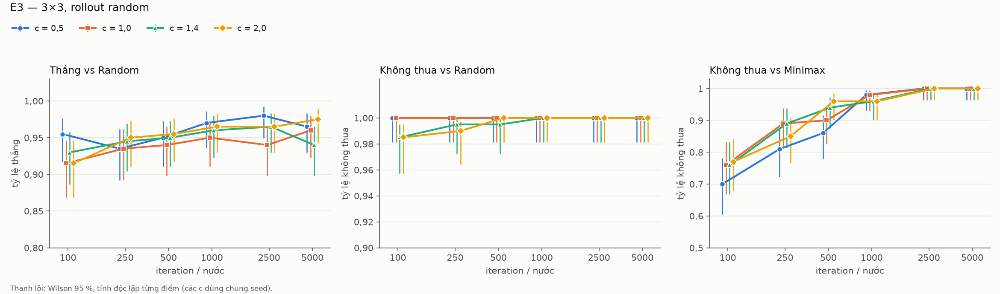 <!-- const: D-18 | 95 -->

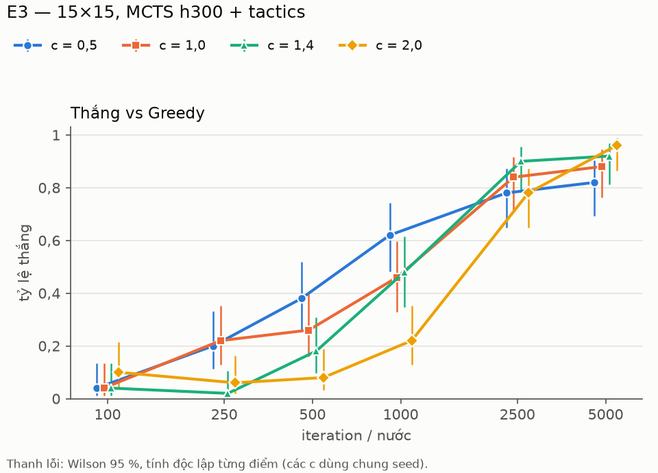

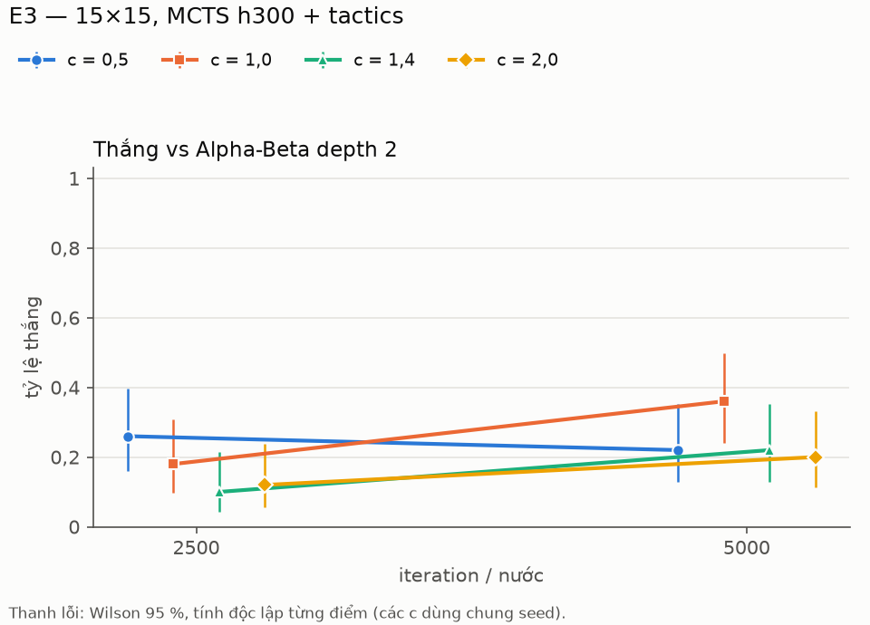 <!-- const: D-18 | 2500 5000 -->

**Bảng 5.** W/D/L của MCTS 3×3 trước Random, 200 ván mỗi ô. <!-- src-table: summary_kinrow.md#Bảng E3 — W/D/L của MCTS, 3×3 vs Random --> <!-- const: D-18 -->

| iter | c = 0,5 | c = 1,0 | c = 1,4 | c = 2,0 |
|---|---|---|---|---|
| 100 | 191/9/0 | 183/17/0 | 186/11/3 | 183/14/3 |
| 250 | 187/13/0 | 187/13/0 | 189/10/1 | 190/8/2 |
| 500 | 190/10/0 | 188/12/0 | 190/9/1 | 191/9/0 |
| 1000 | 194/6/0 | 190/10/0 | 192/8/0 | 193/7/0 |
| 2500 | 196/4/0 | 188/12/0 | 193/7/0 | 193/7/0 |
| 5000 | 193/7/0 | 192/8/0 | 188/12/0 | 195/5/0 |

**Bảng 6.** W/D/L của MCTS 3×3 trước Minimax hoàn hảo, 100 ván mỗi ô. <!-- src-table: summary_kinrow.md#Bảng E3 — W/D/L của MCTS, 3×3 vs Minimax --> <!-- const: D-18 -->

| iter | c = 0,5 | c = 1,0 | c = 1,4 | c = 2,0 |
|---|---|---|---|---|
| 100 | 0/70/30 | 0/76/24 | 0/76/24 | 0/77/23 |
| 250 | 0/81/19 | 0/89/11 | 0/89/11 | 0/85/15 |
| 500 | 0/86/14 | 0/90/10 | 0/94/6 | 0/96/4 |
| 1000 | 0/98/2 | 0/98/2 | 0/96/4 | 0/96/4 |
| 2500 | 0/100/0 | 0/100/0 | 0/100/0 | 0/100/0 |
| 5000 | 0/100/0 | 0/100/0 | 0/100/0 | 0/100/0 |

**Bảng 7.** W/D/L của MCTS h300 15×15 trước Greedy, 50 ván mỗi ô. <!-- src-table: summary_kinrow.md#Bảng E3 — W/D/L của MCTS, 15×15 vs Greedy -->

| iter | c = 0,5 | c = 1,0 | c = 1,4 | c = 2,0 |
|---|---|---|---|---|
| 100 | 2/0/48 | 2/0/48 | 2/0/48 | 5/0/45 |
| 250 | 10/0/40 | 11/0/39 | 1/0/49 | 3/0/47 |
| 500 | 19/0/31 | 13/0/37 | 9/0/41 | 4/0/46 |
| 1000 | 31/0/19 | 23/0/27 | 24/0/26 | 11/0/39 |
| 2500 | 39/0/11 | 42/0/8 | 45/0/5 | 39/0/11 |
| 5000 | 41/0/9 | 44/0/6 | 46/0/4 | 48/0/2 |

**Bảng 8.** W/D/L của MCTS h300 15×15 trước AB2, 50 ván mỗi ô. <!-- src-table: summary_kinrow.md#Bảng E3 — W/D/L của MCTS, 15×15 vs AB -->

| iter | c = 0,5 | c = 1,0 | c = 1,4 | c = 2,0 |
|---|---|---|---|---|
| 2500 | 13/2/35 | 9/0/41 | 5/0/45 | 6/0/44 |
| 5000 | 11/2/37 | 18/0/32 | 11/2/37 | 10/0/40 |

- **3×3.** Trước Random, tỷ lệ thắng nằm trong 0,915–0,980 <!-- src: summary_kinrow.md#E3 --> ở mọi điểm (Hình 1). Trước Minimax, tỷ lệ không thua là 0,70–0,77 <!-- src: summary_kinrow.md#E3 --> ở 100 iteration và đạt 1,00 <!-- src: results/tables/e3_3x3_minimax.csv | c=0.5,iterations=2500,split=all | nonloss_rate --> ở mọi c từ 2500 iteration (Bảng 6). Ở mọi số iteration, khoảng tin cậy của bốn giá trị c chồng lên nhau. <!-- const: D-18 | 100 2500 -->
- **15×15 trước Greedy — giao cắt.** Ở ngân sách thấp, c nhỏ thắng nhiều hơn: tại 1000 iteration, c = 0,5 đạt 0,62 [0,48; 0,74] <!-- src: summary_kinrow.md#E3 --> còn c = 2,0 chỉ 0,22 [0,13; 0,35] <!-- src: summary_kinrow.md#E3 --> ; cặp này cũng có hai khoảng tách nhau ở 500 iteration (c = 0,5: 0,38 [0,26; 0,52] <!-- src: results/tables/e3_greedy.csv | c=0.5,iterations=500,split=all | win_rate,win_lo,win_hi -->, c = 2,0: 0,08 [0,03; 0,19] <!-- src: results/tables/e3_greedy.csv | c=2.0,iterations=500,split=all | win_rate,win_lo,win_hi -->). Ở 250 iteration, c = 1,4 chỉ thắng 0,02 [0,004; 0,105] <!-- src: results/tables/e3_greedy.csv | c=1.4,iterations=250,split=all | win_rate,win_lo,win_hi -->, khoảng tách khỏi c = 0,5 (0,20 [0,11; 0,33] <!-- src: results/tables/e3_greedy.csv | c=0.5,iterations=250,split=all | win_rate,win_lo,win_hi -->) và c = 1,0 (0,22 [0,13; 0,35] <!-- src: results/tables/e3_greedy.csv | c=1.0,iterations=250,split=all | win_rate,win_lo,win_hi -->), nhưng cũng thấp hơn c = 2,0 (3/0/47, Bảng 7) — thứ tự ở mức này không đơn điệu theo c. Ngoài bốn cặp này, mọi cặp c cùng số iteration có khoảng chồng nhau. Ở 5000 iteration thứ tự đảo lại: c = 2,0 đạt 0,96 [0,87; 0,99] <!-- src: summary_kinrow.md#E3 -->, c = 1,4 đạt 0,92 [0,81; 0,97] <!-- src: summary_kinrow.md#E3 -->, c = 1,0 đạt 0,88 [0,76; 0,94] <!-- src: summary_kinrow.md#E3 -->, c = 0,5 đạt 0,82 [0,69; 0,90] <!-- src: summary_kinrow.md#E3 -->, các khoảng chồng nhau. Điểm giao cắt nằm giữa 1000 và 2500 iteration; tại 2500, c = 1,4 cao nhất với 45/0/5 <!-- src: results/tables/e3_greedy.csv | c=1.4,iterations=2500,split=all | wins/draws/losses -->. <!-- const: D-18 | 1000 0,5 2,0 5000 1,4 1,0 2500 500 250 -->
- Tách theo bên đi trước, chênh lệch lớn nhất ở c = 1,4, 1000 iteration: MCTS cầm X thắng 0,72 <!-- src: results/tables/e3_greedy.csv | c=1.4,iterations=1000,split=A=X | win_rate -->, cầm O 0,24 <!-- src: results/tables/e3_greedy.csv | c=1.4,iterations=1000,split=A=O | win_rate --> (25 ván mỗi bên); ở 5000 iteration hai bên bằng nhau với c = 1,4 và c = 2,0. <!-- const: D-18 | 1,4 1000 5000 2,0 -->
- **15×15 trước AB2.** Pilot với c = 2,0 (c có ước lượng điểm cao nhất trước Greedy ở 5000 iteration) thắng 2/20 nên qua cổng và chạy đủ (D-18). Tỷ lệ thắng nằm trong 0,10 <!-- src: results/tables/e3_ab2.csv | c=1.4,iterations=2500,split=all | win_rate -->–0,26 <!-- src: results/tables/e3_ab2.csv | c=0.5,iterations=2500,split=all | win_rate --> ở 2500 iteration và 0,20 <!-- src: results/tables/e3_ab2.csv | c=2.0,iterations=5000,split=all | win_rate -->–0,36 <!-- src: results/tables/e3_ab2.csv | c=1.0,iterations=5000,split=all | win_rate --> ở 5000; cao nhất là c = 1,0 với 0,36 [0,241; 0,499] <!-- src: summary_kinrow.md#E3 -->. Mọi khoảng tin cậy chồng nhau; c có ước lượng điểm cao nhất trước Greedy (2,0) không phải c có ước lượng điểm cao nhất trước AB2. <!-- const: D-18 | 2,0 5000 2500 1,0 -->

### 5.4 Chọn nước theo N hay theo W/N (E4, RQ4)

Thiết lập: Bảng 1, dòng E4 — so nước `max_n` và `max_wn` trên cùng một cây ở gốc; 3×3 so với giá trị trò chơi (thắng / hòa / thua) tính bằng Minimax; 15×15 so với cây tham chiếu 20 000 iteration; đối đầu hai tiêu chí chỉ trên 3×3. <!-- const: D-19 -->

**Bảng 9.** 3×3 (c = 1,4, mọi thế có ít nhất 2 nước): tỷ lệ thế mà hai tiêu chí chọn khác nhau, và trong các thế đó, tỷ lệ nước chọn giữ được giá trị trò chơi. <!-- src-table: summary_kinrow.md#Bảng E4 — 3×3, mọi thế -->

| iter | số thế | max_n ≠ max_wn | giữ giá trị — max_n | giữ giá trị — max_wn |
|---|---|---|---|---|
| 10 | 4298 | 4,4 % | 0,606 | 0,809 |
| 20 | 4298 | 2,6 % | 0,752 | 0,788 |
| 50 | 4298 | 1,3 % | 0,818 | 0,836 |
| 100 | 4298 | 2,3 % | 0,948 | 0,928 |
| 250 | 4298 | 2,6 % | 1,000 | 0,982 |
| 1000 | 4298 | 2,6 % | 1,000 | 1,000 |

**Bảng 10.** Ví dụ W, N, W/N của các con ở gốc một thế 3×3 (100 iteration, c = 1,4); cột "giá trị" là giá trị trò chơi của nước theo góc người đi ở gốc (1 thắng, 0 hòa, −1 thua). <!-- src-table: summary_kinrow.md#Bảng E4 — ví dụ gốc 3×3 --> <!-- const: D-19 | 100 1,4 -->

| ô | W | N | W/N | max N | max W/N | giá trị |
|---|---|---|---|---|---|---|
| 4 | 17,5 | 24 | 0,729 |  | ✓ | 0 |
| 8 | 3,5 | 10 | 0,350 |  |  | −1 |
| 3 | 11,0 | 18 | 0,611 |  |  | 0 |
| 0 | 18,0 | 25 | 0,720 | ✓ |  | 0 |
| 1 | 16,5 | 23 | 0,717 |  |  | 1 |

**Bảng 11.** Đối đầu 3×3 giữa MCTS chọn `max_n` (A) và MCTS chọn `max_wn` (B), cùng số iteration, 200 ván mỗi dòng; score = (W + D/2)/n của `max_n`. <!-- src-table: summary_kinrow.md#Bảng E4 — đối đầu --> <!-- const: D-19 -->

| iter | W/D/L của max_n | score max_n [95 %] | score khi max_n đi trước | score khi max_n đi sau |
|---|---|---|---|---|
| 10 | 89/26/85 | 0,510 [0,45; 0,57] | 0,705 | 0,315 |
| 20 | 76/42/82 | 0,485 [0,42; 0,55] | 0,725 | 0,245 |
| 50 | 54/92/54 | 0,500 [0,45; 0,55] | 0,730 | 0,270 |
| 100 | 37/129/34 | 0,507 [0,47; 0,55] | 0,660 | 0,355 |
| 250 | 21/155/24 | 0,492 [0,46; 0,53] | 0,590 | 0,395 |

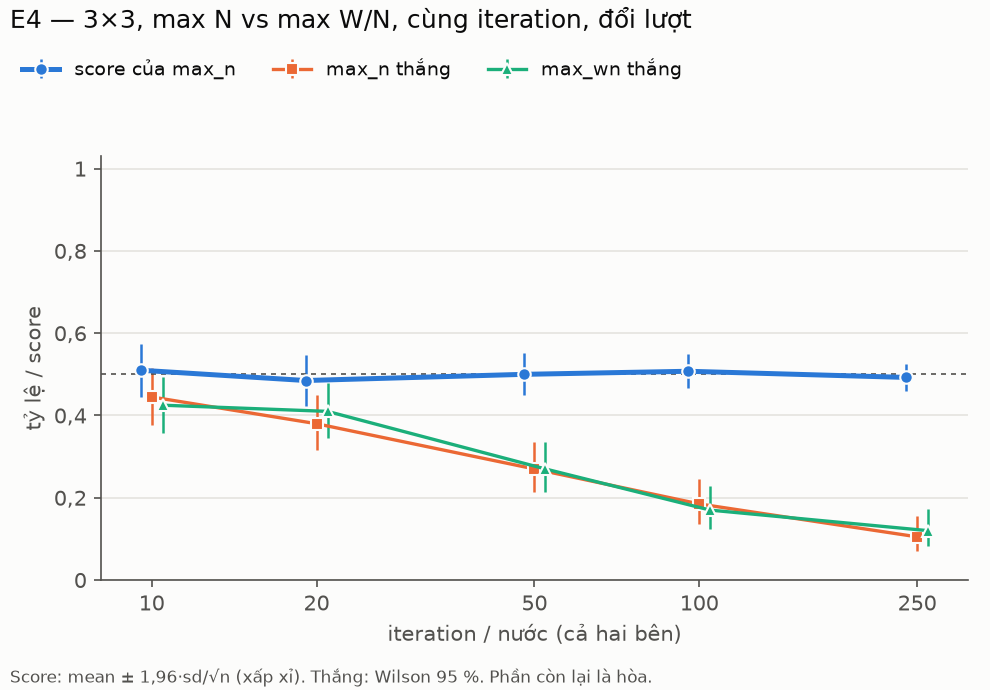

**Bảng 12.** 15×15 (h300 + `check_tactics`, 10 thế × 5 seed): số lần tìm kiếm mà hai tiêu chí chọn khác nhau; tỷ lệ con `max_wn` có W/N = 1; tỷ lệ con `max_n` hòa N với một con khác. <!-- src-table: summary_kinrow.md#Bảng E4 — 15×15 (h300 --> <!-- const: D-19 -->

| c | iter | max_n ≠ max_wn | con max_wn có W/N = 1 | max_n hòa N với con khác |
|---|---|---|---|---|
| 1,4 | 50 | 0/50 | 1,00 | 1,00 |
| 1,4 | 250 | 0/50 | 0,98 | 0,92 |
| 1,4 | 1000 | 0/50 | 0,80 | 0,76 |
| 0,5 | 50 | 0/50 | 1,00 | 1,00 |
| 0,5 | 250 | 2/50 | 0,80 | 0,70 |
| 0,5 | 1000 | 1/50 | 0,64 | 0,54 |

**Bảng 13.** Ví dụ một thế 15×15 (c = 0,5, 250 iteration) mà hai tiêu chí chọn khác nhau: W, N, W/N của các con ở gốc so với chính các con đó trong cây tham chiếu 20 000 iteration (ô đánh số hàng × 15 + cột, từ 0). <!-- src-table: summary_kinrow.md#Bảng E4 — ví dụ gốc 15×15 --> <!-- const: D-19 -->

| ô | W | N | W/N | max N | max W/N | W tham chiếu | N tham chiếu | W/N tham chiếu |
|---|---|---|---|---|---|---|---|---|
| 67 | 11,0 | 12 | 0,917 | ✓ |  | 185,0 | 409 | 0,452 |
| 97 | 11,0 | 11 | 1,000 |  | ✓ | 90,0 | 213 | 0,423 |
| 127 | 11,0 | 11 | 1,000 |  |  | 290,0 | 621 | 0,467 |
| 85 | 11,0 | 11 | 1,000 |  |  | 102,0 | 238 | 0,429 |
| 202 | 9,0 | 10 | 0,900 |  |  | 90,0 | 213 | 0,423 |

- **3×3, tần suất.** Hai tiêu chí chọn khác nhau ở 1,3–4,4 <!-- src: summary_kinrow.md#E4 --> % số thế, tùy số iteration (Bảng 9).
- **3×3, chất lượng khi khác nhau.** Ở 10 iteration, nước `max_wn` giữ giá trị trò chơi thường hơn (0,809 <!-- src: results/tables/e4_roots_summary.csv | board=3x3,set=all,iterations=10 | differ_opt_max_wn --> so với 0,606 <!-- src: results/tables/e4_roots_summary.csv | board=3x3,set=all,iterations=10 | differ_opt_max_n -->); ở 100 iteration `max_n` nhỉnh hơn (0,948 <!-- src: results/tables/e4_roots_summary.csv | board=3x3,set=all,iterations=100 | differ_opt_max_n --> so với 0,928 <!-- src: results/tables/e4_roots_summary.csv | board=3x3,set=all,iterations=100 | differ_opt_max_wn -->) và ở 250 iteration (1,000 <!-- src: results/tables/e4_roots_summary.csv | board=3x3,set=all,iterations=250 | differ_opt_max_n --> so với 0,982 <!-- src: results/tables/e4_roots_summary.csv | board=3x3,set=all,iterations=250 | differ_opt_max_wn -->); ở 1000 iteration cả hai đều giữ giá trị ở mọi thế khác nhau. <!-- const: D-19 | 100 250 1000 -->
- **Ví dụ 3×3 (Bảng 10).** `max_n` chọn ô 0 (N = 25, W/N = 0,720 <!-- src: summary_kinrow.md#E4 -->), `max_wn` chọn ô 4 (N = 24, W/N = 0,729 <!-- src: summary_kinrow.md#E4 -->); cả hai đều là nước hòa, trong khi ô 1 là nước thắng (giá trị 1) với W/N = 0,717 <!-- src: summary_kinrow.md#E4 -->.
- **Đối đầu 3×3 (Bảng 11, Hình 4).** Score của `max_n` nằm trong 0,485 <!-- src: results/tables/e4_match.csv | iterations=20,split=all | score -->–0,510 <!-- src: results/tables/e4_match.csv | iterations=10,split=all | score --> và mọi khoảng tin cậy chứa 0,5. Bên đi trước có lợi thế rõ ở cả hai tiêu chí: score của `max_n` khi đi trước là 0,590 <!-- src: results/tables/e4_match.csv | iterations=250,split=A=X | score -->–0,730 <!-- src: results/tables/e4_match.csv | iterations=50,split=A=X | score -->, khi đi sau 0,245 <!-- src: results/tables/e4_match.csv | iterations=20,split=A=O | score -->–0,395 <!-- src: results/tables/e4_match.csv | iterations=250,split=A=O | score -->. <!-- const: D-19 | 0,5 -->
- **15×15 (Bảng 12).** Với c = 1,4, hai tiêu chí chọn cùng một nước ở 50/50 lần tìm kiếm ở cả ba mức iteration; với c = 0,5 chỉ khác ở 2/50 (250 iteration) và 1/50 (1000). Con `max_wn` có W/N đúng bằng 1 ở mọi lần tìm kiếm (1,00 <!-- src: results/tables/e4_roots_summary.csv | board=15x15,c=1.4,iterations=50 | max_wn_is_1_rate -->) ở 50 iteration và ở 0,80 <!-- src: results/tables/e4_roots_summary.csv | board=15x15,c=1.4,iterations=1000 | max_wn_is_1_rate --> ở 1000 iteration (c = 1,4). <!-- const: D-19 | 0,5 250 1000 1,4 -->
- **Ví dụ 15×15 (Bảng 13).** Ở 250 iteration, `max_wn` chọn ô 97 với W/N = 1,000 <!-- src: summary_kinrow.md#E4 --> (11/11), `max_n` chọn ô 67 với W/N = 0,917 <!-- src: summary_kinrow.md#E4 --> (11/12). Trong cây tham chiếu 20 000 iteration, W/N của năm con có N lớn nhất ở gốc (năm dòng của Bảng 13, gồm cả hai nước được chọn) chỉ còn 0,423 <!-- src: summary_kinrow.md#E4 -->–0,467 <!-- src: summary_kinrow.md#E4 -->; ô 67 có W/N 0,452 <!-- src: summary_kinrow.md#E4 --> và N = 409 <!-- src: summary_kinrow.md#E4 -->, ô 97 có W/N 0,423 <!-- src: summary_kinrow.md#E4 --> và N = 213 <!-- src: summary_kinrow.md#E4 -->. <!-- const: D-19 | 250 20000 -->

### 5.5 Rollout ngẫu nhiên và rollout heuristic (E5, RQ5)

Thiết lập: Bảng 1, dòng E5 — hai cấu hình MCTS chỉ khác rollout (rand, h300), c = 1,4, bật `check_tactics`, 50 ván mỗi điểm; **kết luận chính dựa trên phần cùng thời gian/nước**, phần cùng iteration là phụ (mục 4.4). <!-- const: D-20 -->

**Bảng 14.** Cùng thời gian mỗi nước: tỷ lệ thắng của rand và h300 trước cùng đối thủ, số iteration thực tế mỗi nước (chỉ nước có tìm kiếm), và hiệu cặp theo ván (cùng seed đối thủ, cùng lượt). <!-- src-table: summary_kinrow.md#Bảng E5 — cùng thời gian -->

| đối thủ | thời gian/nước | rand: thắng [Wilson 95 %] | h300: thắng [Wilson 95 %] | iteration thực tế/nước rand / h300 | hiệu cặp h300 − rand [95 %] |
|---|---|---|---|---|---|
| đối đầu (h300 vs rand) | 0,5 s | — | 0,90 [0,79; 0,96] | 1398 / 1322 | — |
| đối đầu (h300 vs rand) | 2,0 s | — | 1,00 [0,93; 1,00] | 5680 / 4006 | — |
| Greedy | 0,5 s | 0,00 [0,00; 0,07] | 0,62 [0,48; 0,74] | 1457 / 1206 | 0,62 [0,48; 0,76] |
| Greedy | 2,0 s | 0,10 [0,04; 0,21] | 0,86 [0,74; 0,93] | 5831 / 4331 | 0,76 [0,63; 0,89] |
| mref | 0,5 s | 0,50 [0,37; 0,63] | 0,98 [0,90; 1,00] | 1399 / 1305 | 0,48 [0,34; 0,62] |
| mref | 2,0 s | 0,92 [0,81; 0,97] | 1,00 [0,93; 1,00] | 5531 / 3829 | 0,08 [0,004; 0,156] |

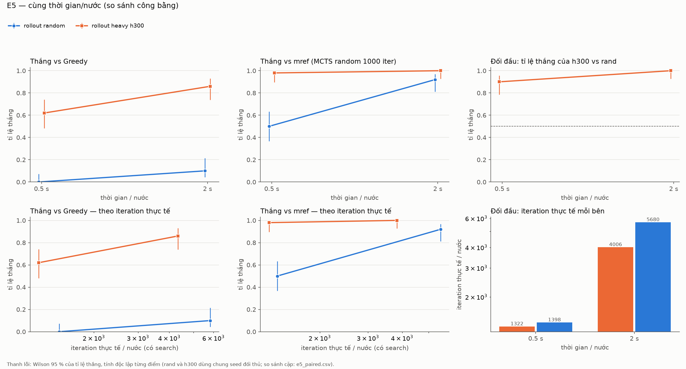

**Bảng 15.** Cùng số iteration mỗi nước (phụ; thiên vị h300 vì một iteration heavy đắt hơn). Điểm h300 trước Greedy và AB2 lấy lại từ E3; AB2 chỉ có pilot 20 ván cho rand. <!-- src-table: summary_kinrow.md#Bảng E5 — cùng số iteration --> <!-- const: D-20 -->

| đối thủ | iter/nước | rand: thắng [Wilson 95 %] | h300: thắng [Wilson 95 %] | ván rand / h300 | hiệu cặp h300 − rand [95 %] |
|---|---|---|---|---|---|
| đối đầu (h300 vs rand) | 250 | — | 0,96 [0,87; 0,99] | — / 50 | — |
| đối đầu (h300 vs rand) | 1000 | — | 0,90 [0,79; 0,96] | — / 50 | — |
| đối đầu (h300 vs rand) | 5000 | — | 0,98 [0,90; 1,00] | — / 50 | — |
| Greedy | 100 | 0,00 [0,00; 0,07] | 0,04 [0,01; 0,13] | 50 / 50 | 0,04 [−0,01; 0,09] |
| Greedy | 250 | 0,00 [0,00; 0,07] | 0,02 [0,004; 0,105] | 50 / 50 | 0,02 [−0,02; 0,06] |
| Greedy | 500 | 0,00 [0,00; 0,07] | 0,18 [0,10; 0,31] | 50 / 50 | 0,18 [0,07; 0,29] |
| Greedy | 1000 | 0,02 [0,004; 0,105] | 0,48 [0,35; 0,61] | 50 / 50 | 0,46 [0,32; 0,60] |
| Greedy | 2500 | 0,00 [0,00; 0,07] | 0,90 [0,79; 0,96] | 50 / 50 | 0,90 [0,82; 0,98] |
| Greedy | 5000 | 0,08 [0,03; 0,19] | 0,92 [0,81; 0,97] | 50 / 50 | 0,84 [0,72; 0,96] |
| mref | 250 | 0,20 [0,11; 0,33] | 0,74 [0,60; 0,84] | 50 / 50 | 0,54 [0,37; 0,71] |
| mref | 1000 | 0,50 [0,37; 0,63] | 0,90 [0,79; 0,96] | 50 / 50 | 0,40 [0,24; 0,56] |
| mref | 5000 | 0,88 [0,76; 0,94] | 1,00 [0,93; 1,00] | 50 / 50 | 0,12 [0,03; 0,21] |
| AB2 | 5000 | 0,00 [0,00; 0,16] | 0,22 [0,13; 0,35] | 20 / 50 | 0,15 [−0,01; 0,31] |

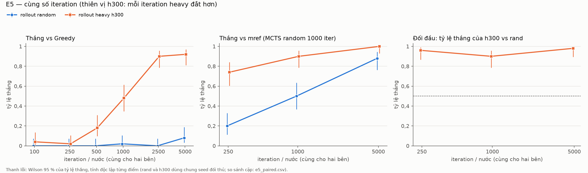

- **Đối đầu cùng thời gian.** h300 thắng rand 0,90 [0,79; 0,96] <!-- src: summary_kinrow.md#E5 --> ở 0,5 s/nước và 50/50 ván ở 2 s/nước (1,00 [0,93; 1,00] <!-- src: summary_kinrow.md#E5 -->). Ở 0,5 s, h300 thắng mọi ván khi cầm X và 0,80 <!-- src: results/tables/e5_h2h.csv | budget_type=time,budget=0.5,split=A=O | win_rate --> khi cầm O. <!-- const: D-20 | 0,5 -->
- **Trước Greedy, cùng thời gian.** rand thắng 0/50 ở 0,5 s và 0,10 <!-- src: results/tables/e5_greedy.csv | budget_type=time,budget=2.0,rollout=rand,split=all | win_rate --> ở 2 s; h300 thắng 0,62 <!-- src: results/tables/e5_greedy.csv | budget_type=time,budget=0.5,rollout=h300,split=all | win_rate --> và 0,86 <!-- src: results/tables/e5_greedy.csv | budget_type=time,budget=2.0,rollout=h300,split=all | win_rate -->. Hiệu cặp h300 − rand: 0,62 [0,48; 0,76] <!-- src: summary_kinrow.md#E5 --> (0,5 s) và 0,76 [0,63; 0,89] <!-- src: summary_kinrow.md#E5 --> (2 s). <!-- const: D-20 | 0,5 -->
- **Trước mref, cùng thời gian.** Ở 0,5 s: rand 0,50 <!-- src: results/tables/e5_mref.csv | budget_type=time,budget=0.5,rollout=rand,split=all | win_rate -->, h300 0,98 <!-- src: results/tables/e5_mref.csv | budget_type=time,budget=0.5,rollout=h300,split=all | win_rate -->, hiệu 0,48 [0,34; 0,62] <!-- src: results/tables/e5_paired.csv | part=mref,budget_type=time,budget=0.5 | diff,paired_lo,paired_hi -->. Ở 2 s: rand 0,92 <!-- src: results/tables/e5_mref.csv | budget_type=time,budget=2.0,rollout=rand,split=all | win_rate -->, h300 1,00, hiệu 0,08 [0,004; 0,156] <!-- src: summary_kinrow.md#E5 -->. <!-- const: D-20 | 0,5 -->
- **Số iteration thực tế.** Ở 0,5 s/nước hai rollout có số iteration gần nhau (đối đầu: rand 1398 <!-- src: results/tables/e5_h2h.csv | budget_type=time,budget=0.5,split=all | b_search_iterations_per_move -->, h300 1322 <!-- src: results/tables/e5_h2h.csv | budget_type=time,budget=0.5,split=all | a_search_iterations_per_move -->); ở 2 s rand nhiều hơn (5680 <!-- src: results/tables/e5_h2h.csv | budget_type=time,budget=2.0,split=all | b_search_iterations_per_move --> so với 4006 <!-- src: results/tables/e5_h2h.csv | budget_type=time,budget=2.0,split=all | a_search_iterations_per_move -->). Benchmark đơn luồng: rand 3606 <!-- src: summary_kinrow.md#E5 --> iteration/giây, h300 2409 <!-- src: summary_kinrow.md#E5 -->, tỷ lệ 1,50 <!-- src: summary_kinrow.md#E5 -->. <!-- const: D-20 | 0,5 -->
- **Cùng iteration (phụ).** Trước Greedy, rand thắng nhiều nhất 0,08 <!-- src: results/tables/e5_greedy.csv | budget_type=iter,budget=5000,rollout=rand,split=all | win_rate --> ở mọi mức iteration, còn h300 đạt 0,48 <!-- src: results/tables/e5_greedy.csv | budget_type=iter,budget=1000,rollout=h300,split=all | win_rate --> ở 1000 và 0,92 <!-- src: results/tables/e5_greedy.csv | budget_type=iter,budget=5000,rollout=h300,split=all | win_rate --> ở 5000. Trước mref, rand đạt 0,20 <!-- src: results/tables/e5_mref.csv | budget_type=iter,budget=250,rollout=rand,split=all | win_rate -->, 0,50 <!-- src: results/tables/e5_mref.csv | budget_type=iter,budget=1000,rollout=rand,split=all | win_rate -->, 0,88 <!-- src: results/tables/e5_mref.csv | budget_type=iter,budget=5000,rollout=rand,split=all | win_rate --> và h300 đạt 0,74 <!-- src: results/tables/e5_mref.csv | budget_type=iter,budget=250,rollout=h300,split=all | win_rate -->, 0,90 <!-- src: results/tables/e5_mref.csv | budget_type=iter,budget=1000,rollout=h300,split=all | win_rate -->, 1,00 <!-- src: results/tables/e5_mref.csv | budget_type=iter,budget=5000,rollout=h300,split=all | win_rate --> ở 250 / 1000 / 5000 iteration (Bảng 15). <!-- const: D-20 | 1000 5000 250 -->
- **AB2 và kiểm tra hợp lệ.** Pilot rand 5000 iteration trước AB2 thắng 0/20 nên không qua cổng (D-20); h300 ở cùng mức (lấy từ E3) thắng 0,22 <!-- src: results/tables/e5_ab2.csv | rollout=h300,split=all | win_rate -->. Đối thủ mref hợp lệ: rand 1000 iteration thắng mref 25/50, tức 0,50 [0,37; 0,63] <!-- src: results/tables/e5_validity.csv | - | win_rate,win_lo,win_hi -->, khoảng chứa 0,5. <!-- const: D-20 | 5000 1000 0,5 -->

### 5.6 Kiểm tra thắng ngay / chặn ngay (E6, RQ6)

Thiết lập: Bảng 1, dòng E6 — (a) bộ thế cờ thật trích từ ván E3/E5: 45 thế đối thủ có four (phải chặn) và 45 thế mình thắng ngay, MCTS **tắt** `check_tactics`, 10 seed mỗi thế; (b) tỷ lệ thắng tắt và bật trên cùng seed; (c) chi phí đo đơn luồng. <!-- const: D-21 -->

**Bảng 16.** Tỷ lệ chọn đúng khi tắt `check_tactics` (trọng số theo pool thế, khoảng bootstrap 95 % theo cụm thế); dòng cuối là kiểm tra khi bật. <!-- src-table: summary_kinrow.md#Bảng E6 — tỷ lệ chọn đúng --> <!-- const: D-21 -->

| iter | chặn four — rand | chặn four — h300 | thắng ngay — rand | thắng ngay — h300 |
|---|---|---|---|---|
| 100 | 0,03 [0,01; 0,06] | 0,50 [0,40; 0,61] | 0,05 [0,03; 0,07] | 0,27 [0,17; 0,40] |
| 500 | 0,08 [0,05; 0,11] | 0,22 [0,12; 0,34] | 0,74 [0,66; 0,81] | 0,28 [0,17; 0,40] |
| 1000 | 0,12 [0,08; 0,16] | 0,14 [0,06; 0,24] | 0,97 [0,95; 0,99] | 0,28 [0,17; 0,40] |
| 2500 | 0,26 [0,20; 0,33] | 0,13 [0,05; 0,24] | 1,00 [1,00; 1,00] | 0,29 [0,18; 0,41] |
| 5000 | 0,38 [0,30; 0,46] | 0,48 [0,36; 0,61] | 1,00 [1,00; 1,00] | 0,39 [0,26; 0,54] |
| bật tactics | 1,00 | 1,00 | 1,00 | 1,00 |

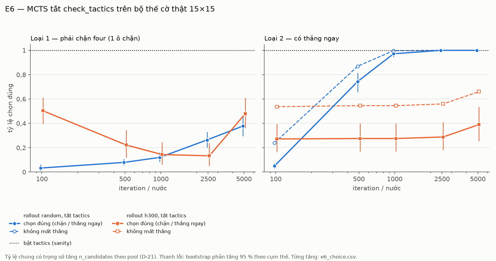

**Bảng 17.** Tỷ lệ thắng khi tắt và khi bật `check_tactics`, so cặp trên cùng seed (50 ván mỗi dòng). <!-- src-table: summary_kinrow.md#Bảng E6 — tỷ lệ thắng tắt -->

| cấu hình | iter | ván | tắt | bật | hiệu bật − tắt [95 %] |
|---|---|---|---|---|---|
| rand vs mref | 1000 | 50 | 0,46 | 0,50 | 0,04 [−0,10; 0,18] |
| h300 vs Greedy | 1000 | 50 | 0,10 | 0,48 | 0,38 [0,23; 0,53] |
| h300 vs Greedy | 5000 | 50 | 0,30 | 0,92 | 0,62 [0,47; 0,77] |

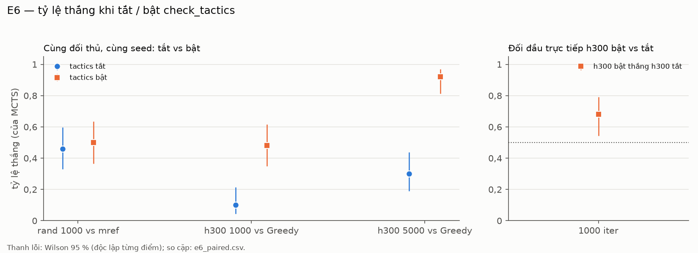

**Bảng 18.** Chi phí một lần gọi `check_tactics` (đơn luồng), và overhead so với một lần MCTS 1000 iteration tắt `check_tactics` trên cùng thế yên tĩnh. <!-- src-table: summary_kinrow.md#Bảng E6 — chi phí --> <!-- const: D-21 | 1000 -->

| loại thế | số thế | ms trung vị | ms tối đa | overhead trung vị — rand | overhead trung vị — h300 |
|---|---|---|---|---|---|
| đối thủ có four (chặn) | 45 | 13,30 | 56,45 | — | — |
| mình thắng ngay | 45 | 0,15 | 0,43 | — | — |
| yên tĩnh (không tactic) | 42 | 27,36 | 98,49 | 7,3 % | 4,4 % |

**Bảng 19.** Tỷ lệ nước đi thẳng (không tìm kiếm) nhờ `check_tactics` trong ván, và thời gian trung bình mỗi nước khi tắt / bật; các ván bật trước Greedy lấy từ E3 (chạy ở thời điểm khác, 4 worker). <!-- src-table: summary_kinrow.md#Bảng E6 — nước đi thẳng -->

| cấu hình (bật) | ván với | nước | đi thẳng (không search) | s/nước tắt | s/nước bật | ván bật lấy từ |
|---|---|---|---|---|---|---|
| rand_i1000 | mref | 672 | 6,1 % | 0,46 | 0,44 | E5 |
| h300_i1000 | h300 tắt (đối đầu) | 274 | 17,2 % | 0,66 | 0,61 | E6 |
| h300_i1000 | Greedy | 371 | 21,3 % | 0,69 | 1,18 | E3 |
| h300_i5000 | Greedy | 491 | 31,0 % | 3,33 | 3,28 | E3 |

- **Chặn four khi tắt kiểm tra (Bảng 16, Hình 7).** Với rollout ngẫu nhiên, tỷ lệ chặn đúng tăng đều từ 0,03 <!-- src: summary_kinrow.md#E6 --> (100 iteration) lên 0,38 <!-- src: summary_kinrow.md#E6 --> (5000). Với h300, tỷ lệ có dạng chữ U: 0,50 <!-- src: summary_kinrow.md#E6 --> ở 100 iteration, giảm còn 0,14 <!-- src: summary_kinrow.md#E6 --> (1000) và 0,13 <!-- src: summary_kinrow.md#E6 --> (2500), rồi tăng lại 0,48 <!-- src: summary_kinrow.md#E6 --> ở 5000. Không cấu hình nào vượt một nửa số thế ở 5000 iteration. <!-- const: D-21 | 100 1000 2500 5000 -->
- **Thắng ngay khi tắt kiểm tra.** Rollout ngẫu nhiên chọn ô thắng ở 0,05 <!-- src: results/tables/e6_choice.csv | type=win,rollout=rand,iter=100,stratum=all | correct_rate --> số lần chạy ở 100 iteration, 0,97 <!-- src: results/tables/e6_choice.csv | type=win,rollout=rand,iter=1000,stratum=all | correct_rate --> ở 1000 và mọi lần từ 2500; h300 ở trong 0,27 <!-- src: results/tables/e6_choice.csv | type=win,rollout=h300,iter=100,stratum=all | correct_rate -->–0,39 <!-- src: results/tables/e6_choice.csv | type=win,rollout=h300,iter=5000,stratum=all | correct_rate --> ở mọi mức iteration. <!-- const: D-21 | 100 1000 2500 -->
- **Khi bật**, mọi thế của cả hai loại được xử lý đúng (dòng cuối Bảng 16).
- **Tỷ lệ thắng (Bảng 17, Hình 8).** Với h300 trước Greedy, bật kiểm tra nâng tỷ lệ thắng từ 0,10 <!-- src: results/tables/e6_paired.csv | part=greedy,iters=1000 | mean_off --> lên 0,48 <!-- src: results/tables/e6_paired.csv | part=greedy,iters=1000 | mean_on --> ở 1000 iteration (hiệu 0,38 [0,23; 0,53] <!-- src: summary_kinrow.md#E6 -->) và từ 0,30 <!-- src: results/tables/e6_paired.csv | part=greedy,iters=5000 | mean_off --> lên 0,92 <!-- src: results/tables/e6_paired.csv | part=greedy,iters=5000 | mean_on --> ở 5000 iteration (hiệu 0,62 [0,47; 0,77] <!-- src: summary_kinrow.md#E6 -->). Với rand trước mref, hiệu 0,04 [−0,10; 0,18] <!-- src: summary_kinrow.md#E6 --> có khoảng chứa 0. Trong đối đầu h300 1000 iteration, bản tắt kiểm tra thắng bản bật 0,32 <!-- src: results/tables/e6_match.csv | part=self,tactics=off,split=all | win_rate --> số ván. <!-- const: D-21 | 1000 5000 -->
- **Chi phí (Bảng 18, 19).** Trên thế yên tĩnh, một lần kiểm tra mất trung vị 27,36 <!-- src: summary_kinrow.md#E6 --> ms (tối đa 98,49 <!-- src: summary_kinrow.md#E6 --> ms), tức overhead trung vị 7,3 <!-- src: summary_kinrow.md#E6 --> % so với MCTS rand 1000 iteration và 4,4 <!-- src: summary_kinrow.md#E6 --> % so với h300. Trong ván, tỷ lệ nước đi thẳng không tìm kiếm là 6,1 <!-- src: summary_kinrow.md#E6 --> % (rand trước mref) đến 31,0 <!-- src: summary_kinrow.md#E6 --> % (h300 5000 iteration trước Greedy). <!-- const: D-21 | 1000 5000 -->

## 6 Thảo luận

Mỗi tiểu mục trả lời một câu hỏi nghiên cứu theo ba bước: kết quả chính (trỏ về bảng và hình ở mục 5), cơ chế giải thích, và mức chắc chắn. Một cơ chế chỉ được khẳng định khi có dữ liệu kiểm chứng trực tiếp; các giải thích còn lại được ghi rõ là **giả thuyết**.

### 6.1 Minimax và Alpha-Beta (RQ1)

**Kết quả.** Alpha-Beta cho cùng giá trị gốc với Minimax ở mọi thế có so với Minimax (3×3 và 15×15 độ sâu 2) và giảm 96,13 <!-- src: results/tables/e1_summary.csv | board=3x3,variant=ab | nodes_saving_vs_minimax_pooled_pct --> % số nút trên 3×3; thêm sắp thứ tự nước (ordering) và bảng chuyển vị (TT) nâng mức giảm lên 99,76 <!-- src: results/tables/e1_summary.csv | board=3x3,variant=ab_order_tt | nodes_saving_vs_minimax_pooled_pct --> %. Trên 15×15 độ sâu 2, Alpha-Beta giảm 53,85 <!-- src: results/tables/e1_summary.csv | board=15x15,depth=2,variant=ab | nodes_saving_vs_minimax_pooled_pct --> % và ordering nâng lên 96,98 <!-- src: results/tables/e1_summary.csv | board=15x15,depth=2,variant=ab_order | nodes_saving_vs_minimax_pooled_pct --> % (Bảng 2).

**Cơ chế.**

- *Đã kiểm chứng:* Alpha-Beta chỉ bỏ những nhánh không thể làm thay đổi giá trị gốc, nên giữ đúng giá trị minimax [4, 5]; dữ liệu khớp ở mọi thế 3×3 và mọi thế 15×15 độ sâu 2 (độ sâu 3 không chạy Minimax). Các biến thể chỉ chọn nước khác Minimax trên 3×3, và khi đó nước được chọn vẫn có giá trị bằng giá trị gốc: khác biệt chỉ xảy ra khi nhiều nước cùng giá trị và thứ tự duyệt quyết định nước nào được giữ.
- *Đã kiểm chứng:* ở cùng số nút, Alpha-Beta có lượng giá tăng dần chạy 0,247 <!-- src: results/tables/e1_summary.csv | board=15x15,depth=2,variant=ab | time_sum --> s so với 3,692 <!-- src: results/tables/e1_summary.csv | board=15x15,depth=2,variant=ab_evalonly | time_sum --> s khi lượng giá lại toàn bàn ở lá. Hai biến thể duyệt cùng số nút, cho cùng giá trị và nước đi ở mọi thế, chỉ khác cách lượng giá, nên chênh lệch thời gian đến từ chi phí lượng giá.
- *Lý thuyết, dữ liệu cùng chiều:* ordering tốt làm cửa sổ (α, β) hẹp lại sớm nên cắt được nhiều nhánh hơn [5]. Số nút giảm đúng như vậy, nhưng chương trình không đếm số lần cắt nên không kiểm được trực tiếp.
- *Giả thuyết:* ở 15×15 độ sâu 2, bản ordering ít nút hơn nhưng chạy 0,265 <!-- src: results/tables/e1_summary.csv | board=15x15,depth=2,variant=ab_order | time_sum --> s so với 0,247 <!-- src: results/tables/e1_summary.csv | board=15x15,depth=2,variant=ab | time_sum --> s, có lẽ vì chi phí chấm `move_score` cho mọi ứng viên không được bù lại ở cây nông. Thời gian chấm điểm chưa được đo riêng. Ở độ sâu 3, ordering rút thời gian từ 5,458 <!-- src: results/tables/e1_summary.csv | board=15x15,depth=3,variant=ab | time_sum --> s xuống 1,256 <!-- src: results/tables/e1_summary.csv | board=15x15,depth=3,variant=ab_order | time_sum --> s.

**Mức chắc chắn.** Cao, vì E1 tất định và không cần khoảng tin cậy. Giới hạn: 15×15 chỉ có 5 thế cố định với độ sâu tối đa 3; mức giảm nút phụ thuộc thế và hàm ordering.

### 6.2 MCTS trên 3×3 có thua không (RQ2)

**Kết quả.** Ở 5000 iteration, kiểm chứng vét cạn không tìm thấy nhánh thua nào trong 5674 <!-- src: results/tables/e2_exhaustive.csv | iterations=5000 | branches --> nhánh (10 seed × 2 vai), và MCTS không thua ván nào trước cả ba đối thủ (Bảng 3, 4). Ở ngân sách thấp MCTS vẫn thua, và mọi ván thua trước Minimax xảy ra khi MCTS cầm O. <!-- const: D-16 | 5000 -->

**Cơ chế.**

- *Lý thuyết:* UCT hội tụ về nước minimax khi số iteration tiến tới vô hạn [1]. Định lý không cho một ngưỡng hữu hạn, nên dữ liệu chỉ cho biết 5000 iteration là đủ với các seed đã kiểm. <!-- const: D-16 | 5000 -->
- *Giả thuyết:* đi sau khó hơn đi trước vì O phải tìm đúng nước đáp ở nhiều thế bị ép hơn X. Dữ liệu cùng chiều nhưng chưa đo trực tiếp số thế bị ép: ở 100 iteration MCTS cầm X hòa Minimax 0/50/0 <!-- src: results/tables/e2_play.csv | label_a=mcts100,label_b=minimax,split=A=X | wins/draws/losses -->, cầm O 0/23/27 <!-- src: results/tables/e2_play.csv | label_a=mcts100,label_b=minimax,split=A=O | wins/draws/losses -->; khi vét cạn ở 100 iteration, 7/10 seed không có nhánh thua khi MCTS cầm X so với 0/10 khi cầm O (Bảng 4). <!-- const: D-16 | 100 -->

**Mức chắc chắn.** Trả lời đề: có — ở 5000 iteration MCTS không thua trong mọi trường hợp đã kiểm, cả đấu ván lẫn vét cạn. Đây là kiểm chứng trên 10 seed, không phải chứng minh cho mọi seed. <!-- const: D-16 | 5000 -->

### 6.3 Ảnh hưởng của hằng số c (RQ3)

**Kết quả.** Trên 3×3, bốn giá trị c không phân biệt được: mọi khoảng tin cậy chồng nhau (Hình 1, Bảng 5–6). Trên 15×15 trước Greedy có giao cắt (Hình 2, Bảng 7): ở 1000 iteration c = 0,5 thắng 0,62 [0,48; 0,74] <!-- src: summary_kinrow.md#E3 --> còn c = 2,0 chỉ 0,22 [0,13; 0,35] <!-- src: summary_kinrow.md#E3 -->; ở 5000 iteration thứ tự đảo lại (c = 2,0: 0,96 [0,87; 0,99] <!-- src: summary_kinrow.md#E3 -->, c = 0,5: 0,82 [0,69; 0,90] <!-- src: summary_kinrow.md#E3 -->) nhưng các khoảng chồng nhau. Trước AB2, không giá trị c nào tách khỏi các giá trị khác (Hình 3). <!-- const: D-18 | 1000 0,5 2,0 5000 -->

**Cơ chế (giả thuyết).** c điều chỉnh đánh đổi khám phá – khai thác của UCB [6]. Với ít iteration, c nhỏ dồn lượt thăm vào vài nước có ước lượng tốt ngay từ đầu; vì rollout h300 đã mang tri thức, khai thác sớm như vậy có lợi. Với nhiều iteration, c lớn khám phá rộng hơn nên ít bỏ sót một nước tốt mà vài rollout đầu đánh giá thấp. Thí nghiệm không ghi hình dạng cây (độ sâu, phân bố N theo c), nên giải thích này chưa được kiểm chứng. Trên 3×3, cây đủ nhỏ để mọi c đều tìm ra nước tốt trong ngân sách — cũng là giả thuyết.

**Mức chắc chắn.** Thấp đến trung bình. Có bốn cặp c (cùng số iteration) mà hai khoảng tin cậy tách nhau (mục 5.3); cả bốn cặp đều cùng chiều "c nhỏ thắng nhiều hơn ở ngân sách thấp", nhưng ở 250 iteration thứ tự không đơn điệu theo c (c = 1,4 thấp hơn cả c = 2,0). Bốn cặp tách nhau này nằm trong 36 phép so sánh (sáu mức iteration, mỗi mức sáu cặp c) không hiệu chỉnh cho đa so sánh (mục 6.7). Đây cũng là khoảng độc lập, không phải so cặp (mục 4.3), và các điểm 5000 iteration đều chồng nhau. Kết luận thực hành: không có giá trị c nào trội ở mọi ngân sách và mọi đối thủ. <!-- const: D-18 | 250 1,4 5000 2,0 -->

### 6.4 Chọn nước theo N hay theo W/N (RQ4)

**Kết quả.** Hai tiêu chí hiếm khi chọn khác nhau: 1,3–4,4 <!-- src: summary_kinrow.md#E4 --> % số thế 3×3 (Bảng 9) và nhiều nhất 2/50 lần tìm kiếm ở 15×15 (Bảng 12). Trong đối đầu 3×3, score của `max_n` nằm trong 0,485 <!-- src: results/tables/e4_match.csv | iterations=20,split=all | score -->–0,510 <!-- src: results/tables/e4_match.csv | iterations=10,split=all | score --> và mọi khoảng tin cậy chứa 0,5 (Bảng 11, Hình 4). Ở 10 iteration, khi hai tiêu chí khác nhau, nước `max_wn` còn giữ giá trị trò chơi thường hơn (0,809 <!-- src: results/tables/e4_roots_summary.csv | board=3x3,set=all,iterations=10 | differ_opt_max_wn --> so với 0,606 <!-- src: results/tables/e4_roots_summary.csv | board=3x3,set=all,iterations=10 | differ_opt_max_n -->). <!-- const: D-19 | 0,5 -->

**Cơ chế.**

- *Có dữ liệu:* W/N của con ít lượt thăm vừa nhiễu vừa dễ bão hòa. Ở 15×15, 50 iteration, con `max_wn` có W/N đúng bằng 1 ở mọi lần tìm kiếm (1,00 <!-- src: results/tables/e4_roots_summary.csv | board=15x15,c=1.4,iterations=50 | max_wn_is_1_rate -->), nên `max_wn` chỉ còn chọn giữa các con hòa nhau. Trong ví dụ Bảng 13, nước `max_wn` có W/N = 1,000 <!-- src: summary_kinrow.md#E4 --> sau 11 lượt thăm nhưng chỉ còn 0,423 <!-- src: summary_kinrow.md#E4 --> trong cây tham chiếu 20 000 iteration. <!-- const: D-19 | 50 20000 -->
- *Lý thuyết:* UCT dồn lượt thăm vào con có ước lượng cao, nên N lớn nhất vừa phản ánh W/N cao vừa có nhiều mẫu nhất ("robust child" [2, 3]). N ít nhạy với một vài rollout may mắn hơn W/N.

**Mức chắc chắn.** "Hai tiêu chí ít khi khác nhau" là chắc chắn. "Chọn theo N thắng nhiều hơn" **không** được đối đầu ủng hộ, và ở 10 iteration dữ liệu còn ngược chiều. Lý do chọn N trong báo cáo này là độ bền của ước lượng (không bị con ít lượt thăm có W/N = 1 chi phối), chứ không phải một hiệu quả đo được.

### 6.5 Rollout ngẫu nhiên và rollout heuristic (RQ5)

**Kết quả.** Cùng thời gian mỗi nước, h300 thắng rand trong đối đầu 0,90 [0,79; 0,96] <!-- src: summary_kinrow.md#E5 --> ở 0,5 s và 1,00 [0,93; 1,00] <!-- src: summary_kinrow.md#E5 --> ở 2 s. Hiệu cặp h300 − rand là 0,62 [0,48; 0,76] <!-- src: summary_kinrow.md#E5 --> (0,5 s) và 0,76 [0,63; 0,89] <!-- src: summary_kinrow.md#E5 --> (2 s) trước Greedy; 0,48 [0,34; 0,62] <!-- src: results/tables/e5_paired.csv | part=mref,budget_type=time,budget=0.5 | diff,paired_lo,paired_hi --> (0,5 s) và 0,08 [0,004; 0,156] <!-- src: summary_kinrow.md#E5 --> (2 s) trước mref (Bảng 14, Hình 5). <!-- const: D-20 | 0,5 -->

**Cơ chế — hai mức thời gian khác nhau.**

- *0,5 s: không phải "chất lượng bù số lượng".* Ở mức này hai rollout chạy số iteration gần như nhau (đối đầu: rand 1398 <!-- src: results/tables/e5_h2h.csv | budget_type=time,budget=0.5,split=all | b_search_iterations_per_move -->, h300 1322 <!-- src: results/tables/e5_h2h.csv | budget_type=time,budget=0.5,split=all | a_search_iterations_per_move --> mỗi nước), nên h300 thắng nhờ ước lượng tốt hơn ở cùng số iteration chứ không phải bù cho số iteration ít hơn. <!-- const: D-20 | 0,5 -->
- *2 s: có chênh lệch số iteration.* Rand chạy 5680 <!-- src: results/tables/e5_h2h.csv | budget_type=time,budget=2.0,split=all | b_search_iterations_per_move --> so với 4006 <!-- src: results/tables/e5_h2h.csv | budget_type=time,budget=2.0,split=all | a_search_iterations_per_move --> iteration mỗi nước mà vẫn thua mọi ván, tức chất lượng ước lượng của h300 bù được số iteration ít hơn.
- *Vì sao tốc độ benchmark (rand 3606 <!-- src: summary_kinrow.md#E5 -->, h300 2409 <!-- src: summary_kinrow.md#E5 --> iteration/giây) không thể hiện ở 0,5 s — giả thuyết có số liệu ủng hộ.* Tốc độ trong ván theo giai đoạn (`e5_rates.csv`, đối đầu 0,5 s) cho thấy rand chỉ nhanh hơn ở đầu ván: nước 0–9, rand 2653 <!-- src: results/tables/e5_rates.csv | part=h2h,budget=0.5,side=B,phase=0-9,method=phase | rate_iter_per_s --> so với h300 1980 <!-- src: results/tables/e5_rates.csv | part=h2h,budget=0.5,side=A,phase=0-9,method=phase | rate_iter_per_s --> iteration/giây; từ nước 10 trở đi h300 không chậm hơn (nước 10–19: h300 3042 <!-- src: results/tables/e5_rates.csv | part=h2h,budget=0.5,side=A,phase=10-19,method=phase | rate_iter_per_s -->, rand 2793 <!-- src: results/tables/e5_rates.csv | part=h2h,budget=0.5,side=B,phase=10-19,method=phase | rate_iter_per_s -->). Ván 0,5 s kéo dài nên nhiều nước rơi vào giai đoạn sau (số nước có tìm kiếm của h300 theo giai đoạn: 211 <!-- src: results/tables/e5_rates.csv | part=h2h,budget=0.5,side=A,phase=0-9,method=phase | n_moves -->, 127 <!-- src: results/tables/e5_rates.csv | part=h2h,budget=0.5,side=A,phase=10-19,method=phase | n_moves -->, 157 <!-- src: results/tables/e5_rates.csv | part=h2h,budget=0.5,side=A,phase=>=20,method=phase | n_moves -->), còn ở 2 s h300 thắng sớm và hầu hết nước nằm ở đầu ván (198 <!-- src: results/tables/e5_rates.csv | part=h2h,budget=2.0,side=A,phase=0-9,method=phase | n_moves -->, 28, 2). Vì sao một iteration h300 rẻ đi ở giữa ván (có thể do rollout heavy kết thúc ván sớm hơn khi bàn đã có nhiều đe dọa) chưa được đo. Ngoài ra nhiều dòng tốc độ này bị gắn cờ lệch benchmark quá 20 % (mục 4.4), nên đây là giả thuyết, chưa phải kết luận. <!-- const: D-20 | 0,5 20 -->
- *Ủng hộ một phần:* `e6_mechanism` (chạy lại cây E6) cho thấy ở 100 iteration, trên các thế đối thủ có four, tỷ lệ con sai (không chặn) có W = 0 là 0,73 [0,64; 0,82] <!-- src: results/tables/e6_mechanism.csv | rollout=h300,iter=100,group=all | frac_wrong_zero,fwz_lo,fwz_hi --> với h300 so với 0,55 [0,53; 0,57] <!-- src: results/tables/e6_mechanism.csv | rollout=rand,iter=100,group=all | frac_wrong_zero,fwz_lo,fwz_hi --> với rand: rollout heavy phạt nước sai ngay từ vài lượt thăm. Đây chỉ là bằng chứng trên thế có four, không suy rộng cho mọi thế. Log-likelihood của lượng giá (−0,566 <!-- src: results/tables/p33_scale_prelim.csv | temperature=300,chosen=1 | mean_loglik --> so với $\ln \tfrac12 \approx -0{,}693$, mục 3.3) cho thấy lượng giá chỉ dự đoán được một phần kết quả rollout. <!-- const: D-21 | 100 -->
- *Liên hệ với value network (khái niệm, không kiểm chứng):* rollout h300 đóng vai trò giống value network của AlphaGo [7, 8] — đưa tri thức vào ước lượng giá trị ở lá thay cho ván chơi ngẫu nhiên. Khác biệt: tri thức của h300 được viết tay (`move_score`, mục 3.3) chứ không học từ dữ liệu; AlphaGo [7] trộn rollout nhanh với value network, còn AlphaGo Zero [8] bỏ hẳn rollout. Rollout có tri thức cũng có mặt trái: h300 có điểm mù có hệ thống khi tắt `check_tactics` (mục 6.6).

**Mức chắc chắn.** Cao cho kết luận "cùng thời gian, h300 tốt hơn rand" trên máy đo, với mọi đối thủ đã thử. Riêng trước mref ở 2 s, biên dưới hiệu cặp chỉ 0,004 <!-- src: summary_kinrow.md#E5 -->, nên mức lợi thế nhỏ và không chắc chắn.

### 6.6 Kiểm tra thắng ngay / chặn ngay (RQ6)

**Kết quả.** Khi tắt `check_tactics`, ở 5000 iteration không cấu hình nào chặn đúng four ở quá một nửa số thế (riêng h300 ở 100 iteration đạt 0,50 <!-- src: summary_kinrow.md#E6 -->, vừa quá một nửa); khi bật, mọi thế được xử lý đúng (Bảng 16, Hình 7). Với h300 trước Greedy, bật kiểm tra nâng tỷ lệ thắng thêm 0,38 [0,23; 0,53] <!-- src: summary_kinrow.md#E6 --> (1000 iteration) và 0,62 [0,47; 0,77] <!-- src: summary_kinrow.md#E6 --> (5000 iteration); với rand trước mref, hiệu 0,04 [−0,10; 0,18] <!-- src: summary_kinrow.md#E6 --> chứa 0 (Bảng 17, Hình 8). Chi phí trung vị là 7,3 <!-- src: summary_kinrow.md#E6 --> % (rand) và 4,4 <!-- src: summary_kinrow.md#E6 --> % (h300) so với MCTS 1000 iteration (Bảng 18). <!-- const: D-21 | 5000 1000 100 -->

**Cơ chế đường chữ U của h300 — đã kiểm chứng.** Chương trình `e6_mechanism` chạy lại đúng các cây của phần chọn nước E6 và khớp dữ liệu thô 100 %; dự đoán được ghi vào D-21 trước khi chạy. Gọi X là bên đang tìm nước (phải chặn) và O là đối thủ đã có four. Trong nhóm lần chọn sai: <!-- const: D-21 -->

- *100 iteration:* rollout heavy phạt nước sai chỉ sau một vài lượt thăm (con sai thường có W = 0, mục 6.5). Lần chọn sai đi kèm việc chính ô chặn bị đánh giá thấp ngay từ đầu: ô chặn có N trung vị chỉ 1 <!-- src: results/tables/e6_mechanism.csv | rollout=h300,iter=100,group=correct=0 | median_n_correct --> và W/N trung bình 0,17 <!-- src: results/tables/e6_mechanism.csv | rollout=h300,iter=100,group=correct=0 | wn_correct -->, tức rollout đầu tiên từ ô chặn thường thua và ô chặn hầu như không được thăm lại. <!-- const: D-21 | 100 -->
- *500–2500 iteration:* dưới một nước sai của X (không chặn), cây lần lượt mở các nước đáp của O, và phần lớn nước đáp được mở chưa phải ô thắng của O. Sau nước đáp như vậy đến lượt X trong rollout; chính sách heavy của X chấm ô chặn cao nên chặn ngay four của O, và rollout không còn phạt nước sai ban đầu. Nhờ vậy nước sai trông rất tốt — ở 1000 iteration W/N của nước sai được chọn là 0,90 <!-- src: results/tables/e6_mechanism.csv | rollout=h300,iter=1000,group=correct=0 | wn_chosen --> so với 0,65 <!-- src: results/tables/e6_mechanism.csv | rollout=h300,iter=1000,group=correct=0 | wn_correct --> của ô chặn, và chỉ 0,20 <!-- src: results/tables/e6_mechanism.csv | rollout=h300,iter=1000,group=correct=0 | refute_rate --> số lần ô thắng của đối thủ đã được mở dưới nước sai. <!-- const: D-21 | 500 2500 1000 -->
- *5000 iteration:* ô thắng của đối thủ được mở dưới nước sai ở 0,97 <!-- src: results/tables/e6_mechanism.csv | rollout=h300,iter=5000,group=correct=0 | refute_rate --> số lần, W/N của nước sai giảm còn 0,70 <!-- src: results/tables/e6_mechanism.csv | rollout=h300,iter=5000,group=correct=0 | wn_chosen --> — việc bác bỏ mới bắt đầu, nên tỷ lệ chặn đúng chỉ tăng trở lại khoảng một nửa. <!-- const: D-21 | 5000 -->
- *Rollout ngẫu nhiên:* W/N của ô chặn gần như không đổi theo iteration (0,46 <!-- src: results/tables/e6_mechanism.csv | rollout=rand,iter=100,group=correct=0 | wn_correct --> ở 100, 0,49 <!-- src: results/tables/e6_mechanism.csv | rollout=rand,iter=5000,group=correct=0 | wn_correct --> ở 5000 iteration, nhóm chọn sai): rollout ngẫu nhiên không phân biệt được ô chặn, chỉ cây sửa được dần, nên tỷ lệ chặn đúng tăng đơn điệu và chậm. <!-- const: D-21 | 100 5000 -->

`check_tactics` bỏ qua toàn bộ quá trình này bằng một phép kiểm trực tiếp. Về thế thắng ngay, h300 có tỷ lệ "thắng ngay" thấp một phần vì nó chọn một nước thắng chắc khác: ở các thế có từ hai ô thắng trở lên, độ đo phụ "không mất thắng" (D-21) đạt 0,99 <!-- src: results/tables/e6_choice.csv | type=win,rollout=h300,iter=100,stratum=mine>=2 | nolose_rate --> ngay ở 100 iteration. MCTS không chiết khấu độ sâu (D-11) nên một nước thắng chậm có cùng W/N với nước thắng ngay. <!-- const: D-21 D-11 | 100 -->

**Vì sao không có khác biệt trước mref — giả thuyết.** mref dùng rollout ngẫu nhiên nên ít khi tạo four có chủ đích; các thế cần chặn hiếm xuất hiện nên bước kiểm tra ít có dịp phát huy. Chưa đếm số thế có four trong các ván này.

**Mức chắc chắn.** Cao cho tác dụng trước Greedy (hiệu cặp, khoảng không chứa 0) và cho cơ chế chữ U của h300 (đã kiểm chứng). Hệ quả cho các mục trước: mọi kết quả 15×15 của E3–E5 là của **MCTS kèm `check_tactics`**, không phải MCTS thuần (D-14). <!-- const: D-14 -->

### 6.7 Hạn chế và mối đe dọa tính hợp lệ

- **Số ván và độ rộng khoảng tin cậy.** Mỗi điểm 15×15 chỉ có 50 ván, nên khoảng Wilson rộng — ví dụ 0,62 [0,48; 0,74] <!-- src: summary_kinrow.md#E3 --> (E3). E3 chỉ có khoảng độc lập, không so cặp; nhiều phép so sánh được đọc cùng lúc mà không hiệu chỉnh cho đa so sánh. <!-- const: D-18 -->
- **Seed.** Các điểm của cùng thí nghiệm dùng chung dãy seed nên kết quả giữa các điểm tương quan (mục 4.3). Kiểm chứng vét cạn E2 chỉ phủ 10 seed.
- **Cổng AB2.** Phần đấu với AB2 chỉ chạy đủ khi pilot qua cổng (D-18, D-20), nên tập điểm được báo cáo đã qua chọn lọc; rand trước AB2 chỉ có pilot 20 ván; giá trị c cho pilot được chọn theo kết quả trước Greedy. <!-- const: D-18 D-20 -->
- **Đo thời gian trên một máy.** Phần "cùng thời gian" của E5 chạy trên một máy xách tay có nhân hiệu năng và nhân tiết kiệm điện, nhạy với tải; E1–E5 không ghi nguồn điện; nhiều dòng tốc độ bị gắn cờ lệch benchmark (mục 4.4). Tỷ lệ tốc độ giữa hai rollout có thể khác trên máy khác, nên kết luận "cùng thời gian" gắn với máy đo.
- **E6 trộn số liệu khác thời điểm.** Các ván "bật" trong Bảng 17 và 19 lấy từ E3/E5, chạy ở thời điểm khác và với số worker khác; hiệu cặp vẫn hợp lệ vì cùng `game_id`, nhưng cột thời gian mỗi nước giữa "tắt" và "bật" không cùng điều kiện đo.
- **Tính hợp lệ cấu trúc.** Mọi tác tử 15×15 chỉ xét `candidate_moves` (tỉa xấp xỉ, mục 3.0). Các đối thủ (Greedy, AB2, mref) đều do nhóm tự viết, không phải người chơi hay chương trình mạnh. Thế cờ E6 được trích từ ván của chính các tác tử này. Với luật tự do (không Renju), Gomoku là thắng cho bên đi trước [9], nên kết quả nhạy với việc đổi lượt. E4 15×15 so với cây tham chiếu 20 000 iteration chứ không phải giá trị thật của thế. <!-- const: D-19 | 20000 -->

### 6.8 Kết luận và hướng phát triển

Alpha-Beta giữ đúng giá trị Minimax và tiết kiệm phần lớn số nút, càng nhiều khi có ordering và TT. MCTS-UCT với đủ iteration không thua trên Tic-Tac-Toe trong mọi trường hợp đã kiểm. Hằng số c không có giá trị trội ở mọi ngân sách và mọi đối thủ. Chọn nước theo N và theo W/N hiếm khi khác nhau; N được ưu tiên vì bền với nhiễu. Rollout heuristic thắng rollout ngẫu nhiên khi so cùng thời gian, và bước kiểm tra thắng ngay / chặn ngay bù cho điểm mù chiến thuật của MCTS trên bàn lớn. Hướng tiếp theo là áp dụng cùng khung tác tử cho cờ tướng (D-30), và thay hàm lượng giá viết tay bằng một hàm giá trị học được, gần với value network [7, 8]. <!-- const: D-30 -->

## Phụ lục A — Chương trình

Mã nguồn tổ chức theo module; mỗi file `X.py` có tài liệu `X.md` cạnh nó (API, thiết kế, giải thích thuật toán, test).

```
gameai/
  core/game.py           giao diện Game chung (current_player, legal_moves, candidate_moves,
                         play, undo, is_terminal, winner, clone, key)
  games/kinrow.py        KInRow(n, k): 3×3 và 15×15, kiểm tra thắng quanh nước vừa đi
  heuristics/            kinrow_eval.py (lượng giá cửa sổ, delta_eval, move_score),
                         kinrow_rollout.py (heavy rollout tăng dần)
  agents/                random_agent, greedy, minimax, alphabeta, mcts, rollout, registry
  arena.py               chơi một ván / một match, seed, đổi lượt
  experiments/           common.py (chạy song song, CSV, resume), e1_nodes … e6_tactics,
                         plots.py (sinh mọi bảng/hình), report_check.py (đối chiếu số trong báo cáo)
  gui/                   giao diện pygame (Phụ lục B)
tests/                   pytest cho mọi module, gồm test hồi quy "golden" k-in-row
results/raw/             dữ liệu thô (chỉ script ghi);  results/tables/, results/figures/: sinh từ raw
```

Lệnh chạy lại (môi trường ảo `.venv`, Python 3.11 trở lên):

```
python -m pytest -q                                   # toàn bộ test
python -m gameai.experiments.e1_nodes                 # E1 (tương tự e2_never_lose, e3_c_sweep,
python -m gameai.experiments.e3_c_sweep --quick       #   e4_final_move, e5_rollout, e6_tactics;
                                                      #   --quick = bản rút gọn để ước tính thời gian)
python -m gameai.experiments.plots                    # sinh lại mọi bảng/hình mục 5 từ results/raw
python -m gameai.experiments.plots --check            # kiểm bảng sinh lại giống byte bản đã lưu
python -m gameai.experiments.report_check             # đối chiếu mọi số trong báo cáo với results/
python -m gameai.gui.pygame_app                       # giao diện chơi (Phụ lục B)
```

## Phụ lục B — Giao diện chơi

Giao diện (pygame) cho phép chơi người với máy, máy với máy và hai người trên bàn 3×3 và 15×15, với hai loại AI (MCTS, Alpha-Beta) ở ba mức Dễ / Vừa / Khó. Mỗi mức ánh xạ sang đúng một cấu hình tác tử; mức MCTS dùng lại cấu hình của thí nghiệm (D-29): 3×3 dùng MCTS của E2 (c = √2 ≈ 1,41) với 100 / 1000 / 5000 iteration, 15×15 dùng MCTS h300 của E3 với 250 / 1000 / 5000 iteration và c = 1,4. <!-- const: D-29 --> Alpha-Beta Khó dùng cấu hình của E1 (3×3: ordering + TT, tìm hết; 15×15: ordering, độ sâu 3). Chế độ "Demo" chạy máy với máy bằng cấu hình thí nghiệm và hiện nguồn cấu hình. Khi bật "Phân tích", giao diện hiện N và W/N của các nước ứng viên ở gốc cây MCTS — chính đại lượng được phân tích ở E4.


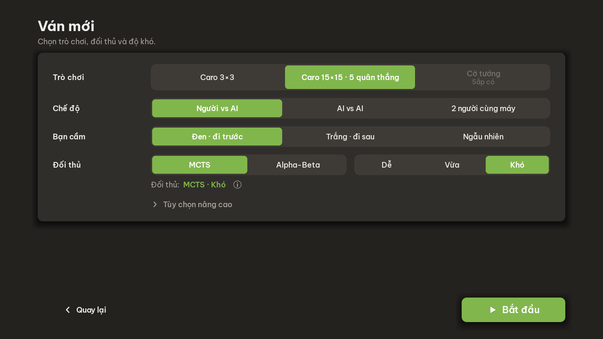


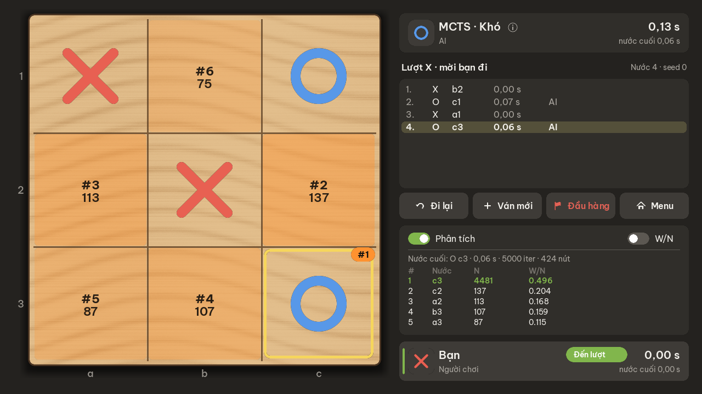


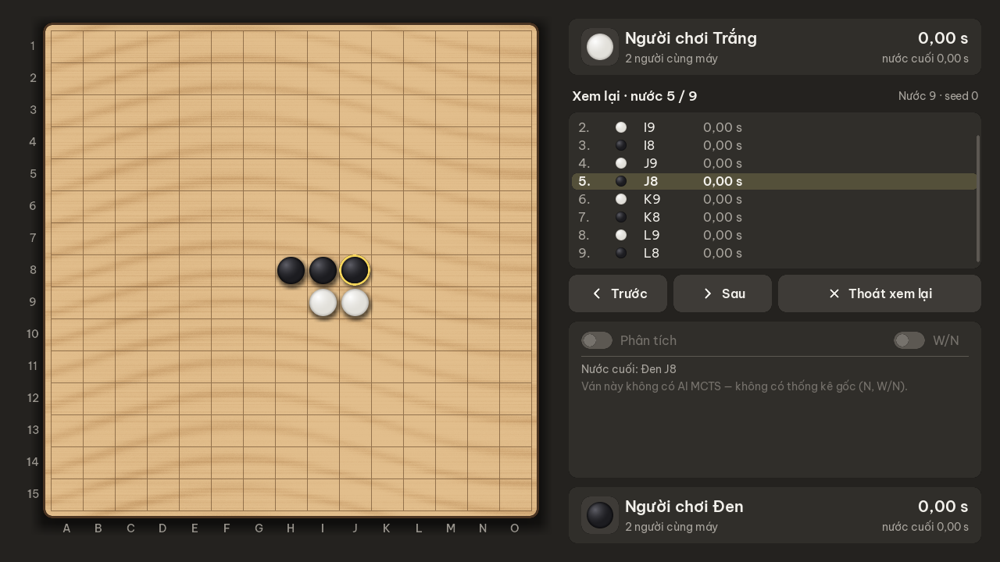

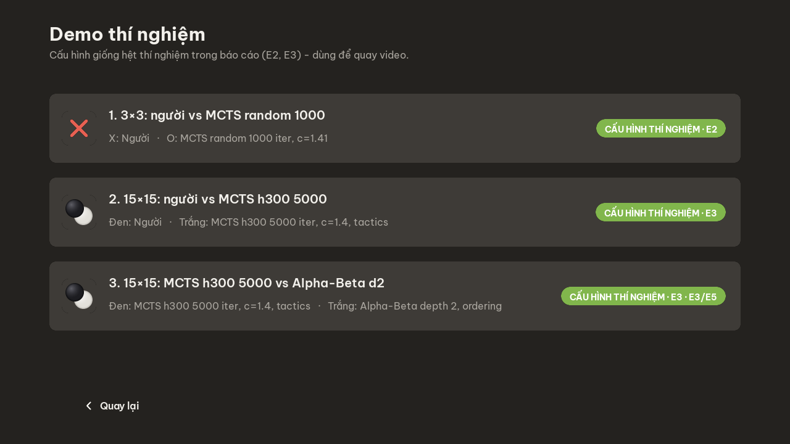

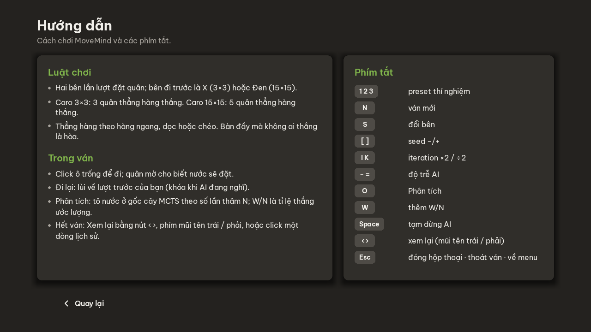

**Thời gian suy nghĩ.** Thời gian/nước được đo bằng script (giao diện chạy không cửa sổ, người chơi được mô phỏng bằng nước ngẫu nhiên có seed, cắm sạc); đây là số minh họa cho giao diện, không phải số liệu thí nghiệm. Với giao diện hoàn chỉnh (**bật** hiệu ứng chuyển động, `p63anim_gui_timing.csv`), MCTS Khó 15×15 mất trung bình 2,046 <!-- src: results/tables/p63anim_gui_timing.csv | board=15,kind=mcts,level=hard,opponent=random_human | mean_s --> s/nước, tối đa 3,909 <!-- src: results/tables/p63anim_gui_timing.csv | board=15,kind=mcts,level=hard,opponent=random_human | max_s --> s; Alpha-Beta Khó 15×15 trung bình 0,104 <!-- src: results/tables/p63anim_gui_timing.csv | board=15,kind=alphabeta,level=hard,opponent=random_human | mean_s --> s. Bàn 3×3 chỉ được đo ở lần đo đầu (`p63_gui_timing.csv`, **tắt** hiệu ứng — lúc đó giao diện chưa có hiệu ứng): MCTS Khó trung bình 0,052 <!-- src: results/tables/p63_gui_timing.csv | board=3,kind=mcts,level=hard,opponent=random_human | mean_s --> s/nước. Lần đo tắt hiệu ứng cho MCTS Khó 15×15 trung bình 1,847 <!-- src: results/tables/p63_gui_timing.csv | board=15,kind=mcts,level=hard,opponent=random_human | mean_s --> s/nước. Chênh lệch giữa hai lần đo **không quy được cho hiệu ứng**: benchmark tốc độ chạy kèm mỗi lần đo cho thấy máy ở lần đo bật hiệu ứng chậm hơn rõ (0,827 <!-- src: results/tables/p63anim_gui_runinfo.csv | - | bench_speed_vs_e5 -->× tốc độ benchmark của E5, so với 0,996 <!-- src: results/tables/p63_gui_runinfo.csv | - | bench_speed_vs_e5 -->× ở lần đo gốc; D-29).

## Tài liệu tham khảo

1. L. Kocsis, C. Szepesvári. Bandit based Monte-Carlo Planning. *Machine Learning: ECML 2006*, LNCS 4212, Springer, 2006, pp. 282–293.
2. C. B. Browne, E. Powley, D. Whitehouse, S. M. Lucas, P. I. Cowling, P. Rohlfshagen, S. Tavener, D. Perez, S. Samothrakis, S. Colton. A Survey of Monte Carlo Tree Search Methods. *IEEE Transactions on Computational Intelligence and AI in Games*, 4(1), 2012, pp. 1–43.
3. R. Coulom. Efficient Selectivity and Backup Operators in Monte-Carlo Tree Search. *Computers and Games (CG 2006)*, LNCS 4630, Springer, 2007, pp. 72–83.
4. S. Russell, P. Norvig. *Artificial Intelligence: A Modern Approach*, 4th ed. Pearson, 2020. Chương 5 (Adversarial Search and Games).
5. D. E. Knuth, R. W. Moore. An Analysis of Alpha-Beta Pruning. *Artificial Intelligence*, 6(4), 1975, pp. 293–326.
6. P. Auer, N. Cesa-Bianchi, P. Fischer. Finite-time Analysis of the Multiarmed Bandit Problem. *Machine Learning*, 47(2–3), 2002, pp. 235–256.
7. D. Silver et al. Mastering the game of Go with deep neural networks and tree search. *Nature*, 529, 2016, pp. 484–489.
8. D. Silver et al. Mastering the game of Go without human knowledge. *Nature*, 550, 2017, pp. 354–359.
9. L. V. Allis. *Searching for Solutions in Games and Artificial Intelligence*. PhD thesis, University of Limburg, Maastricht, 1994.
10. E. B. Wilson. Probable Inference, the Law of Succession, and Statistical Inference. *Journal of the American Statistical Association*, 22(158), 1927, pp. 209–212.
