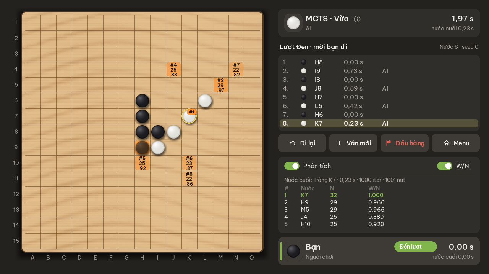
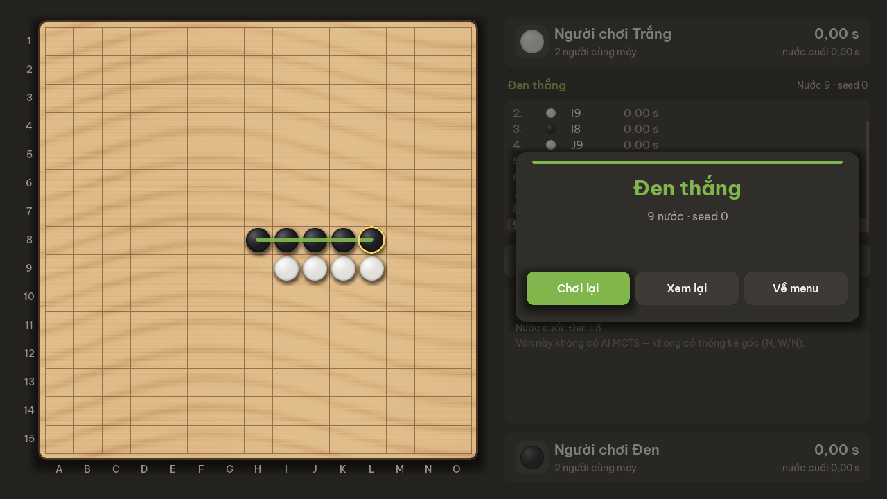

<!--
Quy ước nguồn số liệu (P7.2, D-30) — kiểm bằng `python -m gameai.experiments.report_check`:
  src: file CSV | lọc hàng | cột   → số đứng ngay trước comment phải khớp CSV
  src: summary_kinrow.md#<mục>     → số có nguyên văn trong mục đó của summary
  src-table: summary_kinrow.md#<tiêu đề bảng> → bảng ngay sau giống byte bảng trong summary
  const: D-xx                       → hằng số thiết kế ghi trong docs/DECISIONS.md
  example: <file .md>               → ví dụ tính tay chép từ tài liệu module, không phải số đo
-->

## Tóm tắt

(Viết cuối cùng — đợt (c), sau mục 5–6; giới hạn số từ theo đề, đếm bằng `report_check`.)

## 1 Giới thiệu

Trò chơi k-in-a-row là họ trò chơi hai người trên bàn ô vuông: hai bên lần lượt đặt quân vào ô trống, ai có k quân liên tiếp theo hàng ngang, dọc hoặc chéo trước thì thắng. Tic-Tac-Toe là trường hợp bàn 3×3 với k = 3; Gomoku (cờ caro) là trường hợp bàn 15×15 với k = 5. Đây là bài toán điển hình của tìm kiếm đối kháng: thông tin đầy đủ, tất định, tổng bằng không, nhưng không gian trạng thái của bàn lớn vượt xa khả năng duyệt hết.

Báo cáo so sánh hai họ thuật toán cho bài toán này. Họ thứ nhất là Minimax và cải tiến cắt tỉa Alpha-Beta [4, 5], cần một hàm lượng giá heuristic khi giới hạn độ sâu. Họ thứ hai là Monte Carlo Tree Search với chính sách chọn UCT [1, 2, 3], ước lượng giá trị bằng các ván chơi thử thay vì hàm lượng giá. Ngoài ra báo cáo xét hai cải tiến của MCTS: rollout có tri thức (heuristic) thay cho rollout ngẫu nhiên, gần với ý tưởng value network của AlphaGo [7, 8], và bước kiểm tra "thắng ngay / chặn ngay" trước khi tìm kiếm.

### 1.1 Câu hỏi nghiên cứu

Mỗi câu hỏi ứng với một yêu cầu của đề (ý 1–5) hoặc một thí nghiệm bổ sung (E6); mục 5 trả lời bằng số liệu, mục 6 thảo luận.

- **RQ1** (đề ý 1). Alpha-Beta tiết kiệm bao nhiêu nút so với Minimax, có giữ đúng giá trị và nước đi không; sắp thứ tự nước và bảng chuyển vị (TT) đóng góp thêm bao nhiêu? → thí nghiệm **E1**.
- **RQ2** (đề ý 2). MCTS-UCT trên Tic-Tac-Toe 3×3 có thật sự không bao giờ thua, và cần bao nhiêu iteration? → **E2** (đấu ván và kiểm chứng vét cạn mọi nước đáp của đối thủ).
- **RQ3** (đề ý 3). Hằng số khám phá c ảnh hưởng thế nào tới tỷ lệ thắng theo số iteration? → **E3** (đồ thị iteration – tỷ lệ thắng, mỗi c một đường).
- **RQ4** (đề ý 4). Vì sao chọn nước cuối theo số lần thăm N lớn nhất thay vì tỷ lệ W/N lớn nhất? → **E4** (thống kê W, N, W/N ở gốc và đối đầu hai tiêu chí).
- **RQ5** (đề ý 5). Thay rollout ngẫu nhiên bằng rollout heuristic cải thiện bao nhiêu, khi so cùng số iteration và cùng thời gian; liên hệ với value network? → **E5**.
- **RQ6** (bổ sung). Bước kiểm tra thắng ngay / chặn ngay (`check_tactics`) đóng vai trò gì trong kết quả MCTS 15×15? → **E6**.

### 1.2 Đóng góp và cấu trúc báo cáo

Chương trình được viết bằng Python thuần với một giao diện `Game` chung cho mọi thuật toán, gồm Minimax, Alpha-Beta (ordering, TT, lượng giá tăng dần), MCTS-UCT (rollout ngẫu nhiên và heavy, cắt rollout + lượng giá, kiểm tra chiến thuật), bộ chạy thí nghiệm song song có seed tái lập, và giao diện đồ họa để chơi (Phụ lục B). Mọi bảng và hình trong mục 5 được sinh bằng script từ dữ liệu thô trong `results/raw`; mọi con số trong báo cáo truy được về một file trong `results/`.

Mục 2 phát biểu bài toán hình thức. Mục 3 trình bày phương pháp. Mục 4 mô tả thiết lập thực nghiệm. Mục 5 trình bày kết quả E1–E6, mục 6 thảo luận từng câu hỏi nghiên cứu và hạn chế. Phụ lục A mô tả chương trình, Phụ lục B mô tả giao diện.

## 2 Phát biểu bài toán

### 2.1 Định nghĩa hình thức

Một thể hiện k-in-a-row được xác định bởi kích thước bàn n và số quân cần thẳng hàng k ($k \le n$). Hai người chơi là X (đi trước, ký hiệu $+1$) và O ($-1$).

- **Trạng thái.** $s = (b, p)$ với $b \in \{0, +1, -1\}^{n \times n}$ là nội dung các ô (0 = trống) và $p \in \{+1, -1\}$ là người đến lượt. Trạng thái đầu $s_0$: bàn trống, $p = +1$.
- **Người đến lượt.** $\text{Player}(s) = p$.
- **Hành động.** $A(s) = \{(r, c) : b_{r,c} = 0\}$ — **mọi ô trống**, nếu $s$ chưa kết thúc; $A(s) = \emptyset$ nếu $s$ đã kết thúc.
- **Hàm chuyển.** $T(s, a) = (b', -p)$, trong đó $b'$ giống $b$ trừ $b'_a = p$.
- **Kiểm tra kết thúc.** $\text{Terminal}(s)$ đúng khi có một đường (hàng, cột, hoặc một trong hai hướng chéo) chứa ít nhất k quân liên tiếp cùng màu, hoặc khi bàn đầy. Đường dài hơn k vẫn tính là thắng (luật tự do, không có luật cấm của Renju).
- **Hàm lợi ích.** Với trạng thái kết thúc $s$ và người chơi $q$: $U(s, q) = +1$ nếu $q$ có đường k quân, $-1$ nếu đối thủ có, $0$ nếu bàn đầy mà không ai có (hòa). Trò chơi tổng bằng không: $U(s, +1) = -U(s, -1)$.

Mục tiêu của một tác tử là chọn $a \in A(s)$ tối đa hóa lợi ích của người đến lượt khi đối thủ cũng chơi tối ưu (giá trị minimax). MCTS dùng thang điểm tương đương $\{1, \tfrac{1}{2}, 0\}$ cho thắng / hòa / thua thay cho $\{+1, 0, -1\}$ (mục 3.2).

Kiểm tra kết thúc chỉ cần xét các đường đi qua ô vừa đặt: đếm số quân cùng màu liên tiếp theo hai chiều của bốn hướng, chi phí $O(k)$ thay vì quét cả bàn.

### 2.2 Hai thể hiện được nghiên cứu

- **3×3, k = 3 (Tic-Tac-Toe).** Không gian trạng thái nhỏ, giải được hoàn toàn bằng Minimax; giá trị trò chơi từ bàn trống là hòa. Đây là môi trường kiểm chứng: Minimax cho nước tối ưu tuyệt đối, nên "MCTS không bao giờ thua" kiểm được chính xác (E2, E4).
- **15×15, k = 5 (Gomoku luật tự do).** Hệ số phân nhánh ban đầu bằng số ô của bàn, một ván dài tối đa $15 \times 15 = 225$ nước. Allis [9] đã chứng minh người đi trước thắng với luật này bằng proof-number search, nhưng lời giải đó không dùng được như một đối thủ trong thí nghiệm; trong báo cáo, 15×15 là môi trường mà mọi thuật toán phải dùng heuristic hoặc giới hạn tìm kiếm, và chất lượng được đo bằng tỷ lệ thắng trước các đối thủ cố định.

## 3 Phương pháp

### 3.0 Tập nước ứng viên — tỉa nhánh xấp xỉ

Định nghĩa hình thức ở mục 2 cho phép đi vào mọi ô trống. Trên bàn 15×15, xét mọi ô trống ở mọi nút làm cây tìm kiếm quá rộng với Python thuần (D-3). Mọi thuật toán tìm kiếm trên 15×15 vì vậy chỉ xét **tập ứng viên** `candidate_moves`: các ô trống nằm trong bán kính Chebyshev 2 quanh ít nhất một quân đã đặt; bàn trống chỉ xét ô giữa. Đây là **tỉa nhánh heuristic, không bảo toàn tối ưu**: một nước ở xa mọi quân có thể là nước tốt nhất về lý thuyết nhưng không bao giờ được xét. Kỹ thuật này phổ biến trong chương trình Gomoku vì các nước có ích hầu như luôn nằm gần quân đã có. Trên 3×3, bán kính 2 quanh bất kỳ quân nào phủ cả bàn, nên tập ứng viên trùng với $A(s)$ và mọi kết quả tối ưu trên 3×3 là chính xác.

### 3.1 Minimax và cắt tỉa Alpha-Beta

**Minimax.** Minimax giả định cả hai bên chơi tối ưu: người đi ở gốc (MAX) chọn nước có giá trị lớn nhất, đối thủ (MIN) chọn nước làm giá trị nhỏ nhất. Giá trị một nút được tính đệ quy từ lá lên. Khi giới hạn độ sâu, nút ở độ sâu tối đa được thay bằng hàm lượng giá heuristic. Trạng thái kết thúc được chấm $\pm(\text{WIN} - \text{ply})$ với $\text{WIN} = 10^{12}$ (lớn hơn mọi giá trị heuristic; D-9), trong đó ply là độ sâu tính từ gốc: thắng sớm được điểm cao hơn thắng muộn, thua muộn ít tệ hơn thua sớm.

```
MINIMAX(s, ply):
    nodes += 1
    if s kết thúc:          return +(WIN − ply) nếu gốc thắng, −(WIN − ply) nếu thua, 0 nếu hòa
    if ply = depth:         return eval(s, gốc)
    if lượt của gốc:        return max_m MINIMAX(play(s, m), ply + 1)
    else:                   return min_m MINIMAX(play(s, m), ply + 1)
Chọn nước: argmax_m MINIMAX(play(gốc, m), 1)
```

**Alpha-Beta.** Alpha-Beta tính đúng giá trị minimax nhưng bỏ qua các nhánh không thể ảnh hưởng tới quyết định. Mỗi nút mang cửa sổ $[\alpha, \beta]$: $\alpha$ là giá trị tốt nhất MAX đã chắc chắn có được trên đường từ gốc, $\beta$ là giá trị tốt nhất MIN đã chắc chắn có được. Khi $\alpha \ge \beta$, người chơi ở tầng trên sẽ không bao giờ để ván đi vào nút này nên các con còn lại bị cắt. Thứ tự duyệt càng tốt (nước mạnh trước) thì cắt càng sớm: với thứ tự lý tưởng số nút là $O(b^{d/2})$ so với $O(b^d)$ của Minimax [5].

```
ALPHABETA(s, ply, α, β, score):
    nodes += 1
    if s kết thúc:      return ±(WIN − ply) theo góc nhìn gốc, hòa 0
    if ply = depth:     return score
    if lượt của gốc:    best = −∞
        for m in moves(s) (sắp theo order_fn):
            v = ALPHABETA(play(s,m), ply+1, α, β, score + delta(s,m))
            best = max(best, v);  α = max(α, best);  if α ≥ β: break   # cắt β
    else:               best = +∞
        for m in moves(s):
            v = ALPHABETA(play(s,m), ply+1, α, β, score − delta(s,m))
            best = min(best, v);  β = min(β, best);  if α ≥ β: break   # cắt α
    return best
```

*Ví dụ tính tay* (3×3, X đi; X ở ô 0, 7, 8; O ở 1, 4, 6; ô trống 2, 3, 5; ô đánh số 0–8 theo hàng; O dọa thắng chéo 2–4–6):

```
X O .     X đi 2: O3 → X5 thắng: W−3 ; O5 → X3 hòa: 0  → min = 0.  Gốc: α = 0
. O .     X đi 3: O2 thắng ngay: −(W−2) ≤ α = 0  → CẮT, không xét O5
O X X     X đi 5: O2 thắng ngay: −(W−2) ≤ α = 0  → CẮT, không xét O3
```

Giá trị gốc là 0 và cả hai thuật toán chọn ô 2 (chặn). Minimax thăm 14 nút (1 gốc + 5 + 4 + 4), Alpha-Beta thăm 10 nút (1 + 5 + 2 + 2) với 2 lần cắt. <!-- example: gameai/agents/alphabeta.md -->

**Ba cải tiến của Alpha-Beta trong cài đặt.**

1. *Sắp thứ tự nước* (`order_fn = move_score`): nước thắng ngay và nước chặn nước thắng của đối thủ được xét trước, sau đó theo mức tăng lượng giá; giúp cắt sớm.
2. *Bảng chuyển vị* (TT) theo khóa trạng thái: chỉ dùng lại giá trị đã tính với **cùng** độ sâu còn lại, để giá trị gốc luôn bằng Minimax cùng độ sâu (cần cho so sánh ở E1; D-9).
3. *Lượng giá tăng dần* (`delta_eval`): giá trị lá theo góc nhìn gốc bằng lượng giá ở gốc cộng dồn độ thay đổi của từng nước trên đường đi (cộng nếu gốc đi, trừ nếu đối thủ đi), đúng bằng lượng giá của lá nhưng không phải quét lại toàn bàn.

Khi nhiều nước có cùng giá trị tốt nhất, tác tử chọn có seed (xáo thứ tự ở gốc rồi sắp ổn định theo `order_fn`) để các ván thí nghiệm không trùng nhau.

**Hàm lượng giá theo cửa sổ.** Thay vì đếm riêng từng mẫu (open-three, four, …), hàm lượng giá xét mọi cửa sổ k ô liên tiếp theo bốn hướng. Một cửa sổ còn khả năng thành đường thắng cho một bên chỉ khi không có quân đối phương; càng nhiều quân của bên đó trong cửa sổ thì càng gần thắng (D-8):

$$\text{score}(w) = \begin{cases} +W[a] & \text{nếu } w \text{ chỉ có } a \ge 1 \text{ quân của ta} \\ -W[b] & \text{nếu } w \text{ chỉ có } b \ge 1 \text{ quân đối thủ} \\ 0 & \text{nếu trống hoặc có cả hai màu} \end{cases} \qquad W[c] = 10^{c-1}, \qquad \text{eval}(s, p) = \sum_w \text{score}(w).$$

Hệ số 10 giữa hai mức liên tiếp làm một cửa sổ nhiều quân hơn luôn áp đảo vài cửa sổ ít quân hơn. Hàm chấm nước `move_score` (dùng cho ordering, Greedy và heavy rollout) cộng thêm hai bậc: nước thắng ngay nhận $\text{WIN}_k = 10 \cdot 10^k$, nước chặn một cửa sổ có $k-1$ quân đối thủ được cộng $\text{BLOCK} = \text{WIN}_k / 10$, nằm giữa mức tăng lượng giá thông thường và mức thắng.

*Ví dụ* (15×15, X có open-three, O có four chỉ còn một ô thắng): nước tạo open-four của X có mức tăng lượng giá +1915, nước chặn có mức tăng +1143 nhưng được cộng BLOCK nên `move_score` của nó là 101 143 > 1915 — Greedy và heavy rollout đều chọn chặn. <!-- example: gameai/heuristics/kinrow_eval.md gameai/agents/greedy.md -->

### 3.2 Monte Carlo Tree Search với UCT

**Bản chất.** MCTS xây dần một cây tìm kiếm không đối xứng [2, 3]. Thay vì duyệt hết như Minimax, mỗi vòng lặp (iteration) đi xuống theo nhánh hứa hẹn nhất, thêm một nút mới, chơi thử (rollout) tới hết ván để ước lượng giá trị, rồi cập nhật thống kê trên đường đi. Nhánh tốt được thăm nhiều nên cây mọc sâu ở đó. UCT [1] xem việc chọn con ở mỗi nút như một bài toán multi-armed bandit và áp dụng UCB1 [6].

Mỗi nút lưu $N$ (số lần thăm) và $W$ (tổng điểm), với điểm tính theo góc nhìn **người vừa đi vào nút**: thắng 1, hòa $\tfrac12$, thua 0. Khi mọi con đã được thăm ít nhất một lần, con được chọn là con có

$$\text{UCT}(i) = \frac{W_i}{N_i} + c \sqrt{\frac{\ln N_p}{N_i}},$$

trong đó $N_p$ là số lần thăm nút cha và $c$ là hằng số khám phá. Hạng $W_i/N_i$ là **khai thác** (tỷ lệ điểm trung bình), hạng thứ hai là **khám phá** (lớn với con ít được thăm). Giá trị lý thuyết của UCB1 với điểm trong $[0, 1]$ là $c = \sqrt2 \approx 1{,}41$ (mặc định của cài đặt, dùng ở E2); E3 quét c ∈ {0,5; 1,0; 1,4; 2,0} và dùng c = 1,4 làm giá trị chuẩn cho E4–E6 (mục 4). <!-- const: D-18 D-19 -->

Một iteration gồm bốn bước:

```
MCTS(s0):
    gốc = Node(người_vừa_đi = đối thủ của người đi ở s0, chưa_thử = ứng_viên(s0))
    lặp tới hết ngân sách (iterations hoặc time_limit):
        s = clone(s0); v = gốc
        while v.chưa_thử rỗng và v có con:                # 1. Selection
            v = argmax_con UCT(con);  play(s, v.move)
        if v.chưa_thử khác rỗng:                          # 2. Expansion
            m = rút ngẫu nhiên khỏi v.chưa_thử; p = người đi ở s; play(s, m)
            v = con mới (move m, người_vừa_đi p, chưa_thử = ứng_viên(s))
        chơi theo rollout policy tới khi s kết thúc     # 3. Simulation
        z = kết quả theo góc nhìn X (1 / 0,5 / 0)        #    (bị cắt: value_fn(s))
        while v ≠ null:                                   # 4. Backpropagation
            v.N += 1
            v.W += z nếu v.người_vừa_đi = X, ngược lại 1 − z
            v = v.cha
    return con của gốc có N lớn nhất                      # final_move = "max_n"
```

Bước lan ngược là **chỗ duy nhất lật góc nhìn**: nút do O đi vào nhận $1 - z$. Nhờ vậy ở mọi tầng, Selection chỉ cần chọn con có UCT lớn nhất mà không phân biệt MAX/MIN.

*Ví dụ tính tay* (cùng thế 3×3 như mục 3.1, $c = \sqrt2$, giả sử thứ tự mở rộng 2, 3, 5 và kết quả rollout như dưới):

```
X O .    it1: mở rộng X2; rollout O3, X5 → X thắng, z=1.  X2: W=1 N=1   gốc: W=0 N=1
. O .    it2: mở rộng X3; rollout O2 → O thắng, z=0.      X3: W=0 N=1   gốc: W=1 N=2
O X X    it3: mở rộng X5; rollout O2 → O thắng, z=0.      X5: W=0 N=1   gốc: W=2 N=3
it4: gốc đã mở rộng hết, ln 3 = 1,099: UCT(X2) = 1 + 1,414·1,048 = 2,48; UCT(X3) = UCT(X5) = 1,48 → X2.
     X2 còn chưa thử {3, 5}: mở rộng O3 (nút của O); rollout X5 → X thắng, z=1.
     O3: W += 1 − 1 = 0 (N=1);  X2: W=2 N=2;  gốc: W=2 N=4
it5: ln 4 = 1,386: UCT(X2) = 1 + 1,414·0,832 = 2,18 > UCT(X3) = 1,66 → X2; mở rộng O5; rollout X3 → hòa,
     z=0,5.  O5: W=0,5 N=1;  X2: W=2,5 N=3;  gốc: W=2,5 N=5
```

Sau năm iteration MCTS chọn X2 (N = 3) — đúng nước chặn duy nhất, giống Minimax.

**Chọn nước cuối.** Sau khi hết ngân sách, nước được chọn là con của gốc có $N$ lớn nhất (`max_n`; hòa thì so W). Phương án thay thế là con có $W/N$ lớn nhất (`max_wn`). E4 so sánh hai tiêu chí; mục 6 thảo luận vì sao $N$ là lựa chọn chuẩn.

**Ngân sách.** Tìm kiếm dừng khi đạt số iteration hoặc giới hạn thời gian/nước (`time_limit`), tùy cái nào đến trước. Chỉ ngân sách iteration là tái lập được theo seed; ngân sách thời gian phụ thuộc tốc độ máy (mục 4.4).

**Kiểm tra chiến thuật trước khi tìm kiếm (`check_tactics`, D-11).** Nếu bật, trước khi chạy MCTS tác tử: (i) đi ngay nếu có nước thắng ngay; (ii) tính tập nước "an toàn" S — các nước mà sau đó đối thủ không có nước thắng ngay; nếu $|S| = 1$ thì đi luôn (nước chặn bắt buộc); nếu S rỗng hoặc bằng toàn bộ tập ứng viên thì tìm kiếm bình thường; còn lại thì chỉ tìm kiếm trên S. Phép kiểm tra chỉ dùng `play`/`undo` của giao diện `Game` nên không phụ thuộc trò chơi. Lý do cần bước này trên 15×15: MCTS thuần chỉ "bác bỏ" một nước không chặn sau khi nút con của nó được mở rộng tới đúng nước thắng của đối thủ, trong khi số ứng viên ở mỗi tầng rất lớn; với ngân sách vừa phải, MCTS thuần thường không chặn được four (D-14; đo ở E6).

**MCTS thuần ưu tiên "thắng chắc", không ưu tiên "thắng nhanh".** Khác Minimax với thang $\pm(\text{WIN} - \text{ply})$, MCTS ước lượng xác suất thắng và không chiết khấu theo độ sâu: ở thế có một nước thắng ngay và một nước tạo ba đường dọa (thắng chắc sau hai nước), cả hai con có $W/N = 1$ và MCTS có thể chọn nước thứ hai. Cả hai thuật toán không bỏ lỡ chiến thắng, nhưng chỉ Minimax ưu tiên thắng nhanh nhất (D-11).

### 3.3 Chính sách rollout

**Rollout ngẫu nhiên.** Mỗi bước chọn đều một nước trong tập ứng viên. Ước lượng không thiên lệch theo nghĩa không đưa tri thức nào vào, nhưng nhiễu: hai bên bỏ qua cả nước thắng ngay lẫn nước chặn, nên kết quả ván thử ít liên quan tới giá trị thật của thế cờ, nhất là trên 15×15 khi ván thử dài.

**Rollout heavy (softmax trên điểm heuristic).** Mỗi bước chọn nước $m$ với xác suất

$$P(m) = \frac{\exp\big((s_m - s_{\max})/T\big)}{\sum_j \exp\big((s_j - s_{\max})/T\big)}, \qquad s_m = \text{move\_score}(s, m),$$

với nhiệt độ $T$. Vì bậc thắng ngay / chặn ngay cách mức tăng lượng giá thông thường nhiều bậc, nước thắng ngay và nước chặn được chọn với xác suất gần 1; các nước thường được chọn theo mức tăng lượng giá, có ngẫu nhiên. Ván thử vì vậy giống ván thật hơn: mỗi rollout ít nhiễu hơn nhưng đắt hơn. Do đó so sánh công bằng phải xét **cả cùng số iteration lẫn cùng thời gian** (E5).

Cài đặt heavy rollout dùng cấu trúc tăng dần: giữ số quân của từng cửa sổ và điểm của từng ô cho mỗi bên, mỗi nước chỉ cập nhật các cửa sổ đi qua ô vừa đặt thay vì chấm lại mọi ứng viên. Đây vẫn là **cùng một chính sách** (test kiểm cùng điểm từng bước, cùng chuỗi nước, cùng cây MCTS), chỉ rẻ hơn (D-12).

**Cắt rollout và lượng giá.** Có thể dừng rollout sau L nước và thay phần "chơi tiếp tới hết" bằng ước lượng xác suất thắng $\sigma(\text{eval}(s, X) / \text{scale}) = 1 / (1 + e^{-\text{eval}(s,X)/\text{scale}})$, với scale hiệu chỉnh bằng hồi quy logistic trên kết quả rollout. Đây là phiên bản thủ công của **value network** trong AlphaGo [7, 8]: một hàm ước lượng giá trị thế cờ thay cho (hoặc trộn với) mô phỏng tới hết ván.

**Cấu hình được chọn.** Trong quét sơ bộ trước E5 (P3.3: T ∈ {100, 300, 1000} × {không cắt; cắt 10 nước + lượng giá}, 20 ván mỗi cấu hình), luật chọn định trước chọn **h300**: heavy rollout, T = 300, không cắt (D-14). <!-- const: D-12 D-14 --> Hàm lượng giá qua sigmoid chỉ dự đoán được một phần kết quả rollout: log-likelihood trung bình mỗi thế ở T = 300 là −0,566 <!-- src: results/tables/p33_scale_prelim.csv | temperature=300,chosen=1 | mean_loglik --> so với $\ln \tfrac12 \approx -0{,}693$ của dự đoán hằng $\tfrac12$. Vì vậy E3–E5 dùng h300 không cắt; mối liên hệ với value network được thảo luận ở mục 6.

### 3.4 Cờ tướng

(Bổ sung sau P8 — luật, hàm lượng giá, Alpha-Beta và MCTS cho cờ tướng.)

## 4 Thiết lập thực nghiệm

### 4.1 Phần cứng và phần mềm

Mọi thí nghiệm chạy trên cùng một máy xách tay: CPU 12th Gen Intel(R) Core(TM) i9-12900H <!-- src: results/raw/e5_runinfo.csv | step=h2h-iter,budget=250 | cpu -->, 20 <!-- src: results/raw/e5_runinfo.csv | step=h2h-iter,budget=250 | logical_cpus --> luồng logic (kiến trúc lẫn nhân hiệu năng và nhân tiết kiệm điện). Phần mềm: CPython 3.13.14 <!-- src: results/tables/p72_env.csv | key=python | value -->, numpy 2.5.4 <!-- src: results/tables/p72_env.csv | key=numpy | value -->, matplotlib 3.11.2 <!-- src: results/tables/p72_env.csv | key=matplotlib | value -->, pygame 2.6.1 <!-- src: results/tables/p72_env.csv | key=pygame | value --> (giao diện), trên Windows 11 (10.0.26200) <!-- src: results/tables/p72_env.csv | key=os | value -->. Phiên bản phần mềm được ghi lúc viết báo cáo, trong cùng môi trường ảo đã chạy thí nghiệm; các file chạy thí nghiệm không ghi phiên bản Python.

Mỗi điểm thí nghiệm ghi commit git của mã nguồn và cờ "mã có sửa chưa commit" vào dữ liệu thô. Các ván chạy song song bằng nhiều tiến trình (worker), mỗi ván một tác tử mới (không giữ cây/TT giữa các ván). Nguồn điện: E6 và các phép đo thời gian giao diện ghi rõ chạy khi cắm sạc (AC <!-- src: results/raw/e6_runinfo.csv | step=bench | power -->); E1–E5 không ghi nguồn điện. Các thí nghiệm dùng ngân sách iteration không phụ thuộc tốc độ máy; riêng phần "cùng thời gian" của E5 nhạy với tải, được chạy khi máy rảnh với 2 <!-- src: results/raw/e5_runinfo.csv | step=h2h-time,budget=0.5 | workers --> worker và có kiểm tra tốc độ (mục 4.4).

### 4.2 Các tác tử và đối thủ

- **Random.** Chọn đều một ô trống (`legal_moves`). Dùng làm đối thủ yếu trên 3×3.
- **Minimax hoàn hảo (3×3).** Minimax không giới hạn độ sâu; khi nhiều nước cùng giá trị tốt nhất thì chọn ngẫu nhiên có seed trong số đó, để các ván không trùng nhau. Bản dùng trong E3 nhớ danh sách nước tối ưu theo khóa trạng thái để chạy nhanh (D-18).
- **Greedy (15×15).** Tham lam một nước: chấm mọi ứng viên bằng `move_score` (mục 3.1), chọn nước điểm cao nhất, hòa thì chọn ngẫu nhiên có seed. Biết thắng ngay và chặn ngay nhưng không thấy phản ứng của đối thủ.
- **AB2 (15×15).** Alpha-Beta độ sâu 2 với hàm lượng giá cửa sổ, lượng giá tăng dần và ordering `move_score` (D-10). Mạnh hơn Greedy vì thấy nước đáp của đối thủ; dùng để tránh hiệu ứng trần khi MCTS thắng gần hết Greedy.
- **mref (15×15, E5–E6).** MCTS rollout ngẫu nhiên, 1000 iteration cố định, c = 1,4, bật `check_tactics`; dãy seed bên trong tách riêng khỏi seed của tác tử đang được đánh giá (D-20). <!-- const: D-20 --> Đây là đối thủ cùng loại, mức trung bình, để phân biệt các cấu hình rollout khi Greedy và AB2 cho kết quả ở sàn hoặc trần.
- **MCTS được đánh giá.** 3×3: rollout ngẫu nhiên, `check_tactics` tắt — đo đúng thuật toán gốc. 15×15: rollout h300 (hoặc rollout ngẫu nhiên ở E5), **`check_tactics` bật ở mọi cấu hình E3–E5** (D-14); E6 là nơi duy nhất so bật/tắt. Chọn nước cuối theo $N$ lớn nhất, trừ E4.

### 4.3 Thiết kế ván đấu và thống kê

**Seed và đổi lượt.** Ván được tổ chức theo cặp: cặp thứ $i$ có seed $s_i = s_0 + i$; seed của từng tác tử được dẫn xuất từ $s_i$ bằng hàm băm (SHA-256), không phụ thuộc trạng thái ngẫu nhiên toàn cục. Mỗi cặp gồm hai ván với cùng seed: tác tử A cầm X rồi tác tử B cầm X — **đổi lượt đi trước** như đề yêu cầu. Mọi kết quả được báo cả tổng và tách theo bên đi trước. Cột `distinct_games` đếm số chuỗi nước khác nhau để phát hiện ván trùng (làm khoảng tin cậy hẹp giả).

**Số ván.** Mỗi điểm thí nghiệm 15×15 có 50 ván (25 cặp); 3×3 có 100–200 ván/điểm vì rẻ và cần độ chính xác cao khi gần trần (Bảng 1). <!-- const: D-16 D-18 D-20 -->

**Độ đo.** Tỷ lệ thắng $\hat p = W/n$ và tỷ lệ không thua $(W + D)/n$, kèm khoảng tin cậy Wilson 95 % [10]: <!-- const: D-13 -->

$$\frac{\hat p + \frac{z^2}{2n} \pm z\sqrt{\frac{\hat p(1-\hat p)}{n} + \frac{z^2}{4n^2}}}{1 + \frac{z^2}{n}}, \qquad z = 1{,}96.$$

Điểm số $(W + \tfrac12 D)/n$ (dùng ở E4) không phải tỷ lệ nhị thức nên dùng khoảng xấp xỉ chuẩn $\bar x \pm 1{,}96\, s/\sqrt n$. Ngoài ra: số nút (E1; MCTS: số nút của cây), thời gian/nước, số iteration thực tế/nước (chỉ tính nước có tìm kiếm, bỏ nước đi thẳng nhờ `check_tactics`; D-15).

**Khoảng độc lập và so sánh cặp.** Khoảng Wilson được tính **độc lập từng điểm**. Tuy nhiên các điểm khác nhau của cùng thí nghiệm dùng chung seed (ví dụ bốn giá trị c gặp đối thủ với cùng dãy seed), nên hai khoảng chồng nhau không có nghĩa là không khác nhau, và hai khoảng tách nhau cũng chưa phải kiểm định cặp (D-18). Khi cần kết luận "A tốt hơn B" (E5, E6), báo cáo dùng **so sánh cặp** theo ván: $d_j = r^A_j - r^B_j$ trên cùng `game_id` (cùng seed đối thủ, cùng lượt), khoảng $\bar d \pm 1{,}96\, s_d / \sqrt n$. E6 tính tỷ lệ chọn đúng trên bộ thế cờ bằng bootstrap phân tầng theo thế (D-21).

### 4.4 Ngân sách iteration và ngân sách thời gian

Hầu hết thí nghiệm dùng **ngân sách iteration** (iteration ∈ {100, 250, 500, 1000, 2500, 5000}, như đề): tái lập được theo seed, không phụ thuộc tải máy, nên chạy song song 4 worker an toàn. <!-- const: D-18 --> Nhưng một iteration của heavy rollout đắt hơn một iteration ngẫu nhiên, nên so cùng iteration **thiên vị** rollout heavy. E5 vì vậy thêm **ngân sách thời gian** (0,5 s và 2 s mỗi nước, chạy 2 worker khi máy rảnh) — đây là so sánh công bằng và là cơ sở kết luận chính của E5. <!-- const: D-20 --> Vì tốc độ thay đổi theo giai đoạn ván và tải máy, E5 so tốc độ thực tế (iteration/giây theo nhóm giai đoạn ván) với một benchmark đơn luồng và gắn cờ khi lệch quá 20 %; cờ không dùng để loại dữ liệu (D-20). <!-- const: D-20 -->

### 4.5 Tóm tắt thiết lập E1–E6

**Bảng 1.** Thiết lập các thí nghiệm (chi tiết và lý do trong các quyết định D-xx).

| E | Câu hỏi | Bàn | Tác tử được đánh giá | Đối thủ / phép đo | Ngân sách | Ván/điểm | Quyết định |
|---|---|---|---|---|---|---|---|
| E1 | RQ1 | 3×3; 15×15 | Minimax, AB, AB + ordering, AB + ordering + TT | số nút, thời gian, giá trị và nước đi trên bàn trống + 5 thế (3×3), 5 thế cố định (15×15) | 3×3 tìm hết; 15×15 độ sâu 2 và 3 | — (tất định) | D-17 <!-- const: D-17 --> |
| E2 | RQ2 | 3×3 | MCTS rollout ngẫu nhiên, c = √2 ≈ 1,41 (mặc định) | Minimax hoàn hảo, Random, MCTS cùng iteration; vét cạn mọi nước đáp của đối thủ, 10 seed × 2 vai | 100, 250, 1000, 5000 iteration | 100 | D-16 <!-- const: D-16 --> |
| E3 | RQ3 | 3×3; 15×15 | MCTS, c ∈ {0,5; 1,0; 1,4; 2,0} | 3×3: Random (200 ván), Minimax (100 ván); 15×15 h300: Greedy, AB2 (có cổng pilot) | 100 … 5000 iteration (AB2: 2500, 5000) | 50–200 | D-18 <!-- const: D-18 --> |
| E4 | RQ4 | 3×3; 15×15 | MCTS chọn `max_n` vs `max_wn` | 3×3: mọi thế ≥ 2 nước, đối đầu 200 ván/điểm; 15×15: 10 thế × 5 seed, tham chiếu 20 000 iteration | 3×3: 10 … 1000; 15×15: 50, 250, 1000 iteration | 200 | D-19 <!-- const: D-19 --> |
| E5 | RQ5 | 15×15 | MCTS rollout ngẫu nhiên (rand) vs h300, c = 1,4 | đối đầu, Greedy, mref; AB2 có cổng pilot | iteration 100 … 5000; thời gian 0,5 s và 2 s/nước | 50 | D-20 <!-- const: D-20 --> |
| E6 | RQ6 | 15×15 | MCTS bật vs tắt `check_tactics` (rand, h300) | tỷ lệ chọn đúng trên bộ thế cờ thật (chặn four, thắng ngay); win rate vs Greedy, mref; chi phí | 100 … 5000 iteration | 50 | D-21 <!-- const: D-21 --> |

## 5 Kết quả

(Đợt (b) — chưa viết.)

## 6 Thảo luận

(Đợt (c) — chưa viết.)

## Phụ lục A — Chương trình

Mã nguồn tổ chức theo module; mỗi file `X.py` có tài liệu `X.md` cạnh nó (API, thiết kế, giải thích thuật toán, test).

```
gameai/
  core/game.py           giao diện Game chung (current_player, legal_moves, candidate_moves,
                         play, undo, is_terminal, winner, clone, key)
  games/kinrow.py        KInRow(n, k): 3×3 và 15×15, kiểm tra thắng quanh nước vừa đi
  heuristics/            kinrow_eval.py (lượng giá cửa sổ, delta_eval, move_score),
                         kinrow_rollout.py (heavy rollout tăng dần)
  agents/                random_agent, greedy, minimax, alphabeta, mcts, rollout, registry
  arena.py               chơi một ván / một match, seed, đổi lượt
  experiments/           common.py (chạy song song, CSV, resume), e1_nodes … e6_tactics,
                         plots.py (sinh mọi bảng/hình), report_check.py (đối chiếu số trong báo cáo)
  gui/                   giao diện pygame (Phụ lục B)
tests/                   pytest cho mọi module, gồm test hồi quy "golden" k-in-row
results/raw/             dữ liệu thô (chỉ script ghi);  results/tables/, results/figures/: sinh từ raw
```

Lệnh chạy lại (môi trường ảo `.venv`, Python 3.11 trở lên):

```
python -m pytest -q                                   # toàn bộ test
python -m gameai.experiments.e1_nodes                 # E1 (tương tự e2_never_lose, e3_c_sweep,
python -m gameai.experiments.e3_c_sweep --quick       #   e4_final_move, e5_rollout, e6_tactics;
                                                      #   --quick = bản rút gọn để ước tính thời gian)
python -m gameai.experiments.plots                    # sinh lại mọi bảng/hình mục 5 từ results/raw
python -m gameai.experiments.plots --check            # kiểm bảng sinh lại giống byte bản đã lưu
python -m gameai.experiments.report_check             # đối chiếu mọi số trong báo cáo với results/
python -m gameai.gui.pygame_app                       # giao diện chơi (Phụ lục B)
```

## Phụ lục B — Giao diện chơi

Giao diện (pygame) cho phép chơi người với máy, máy với máy và hai người trên bàn 3×3 và 15×15, với hai loại AI (MCTS, Alpha-Beta) ở ba mức Dễ / Vừa / Khó. Mỗi mức ánh xạ sang đúng một cấu hình tác tử; mức MCTS dùng lại cấu hình của thí nghiệm (D-29): 3×3 dùng MCTS của E2 (c = √2 ≈ 1,41) với 100 / 1000 / 5000 iteration, 15×15 dùng MCTS h300 của E3 với 250 / 1000 / 5000 iteration và c = 1,4. <!-- const: D-29 --> Alpha-Beta Khó dùng cấu hình của E1 (3×3: ordering + TT, tìm hết; 15×15: ordering, độ sâu 3). Chế độ "Demo" chạy máy với máy bằng cấu hình thí nghiệm và hiện nguồn cấu hình. Khi bật "Phân tích", giao diện hiện N và W/N của các nước ứng viên ở gốc cây MCTS — chính đại lượng được phân tích ở E4.








**Thời gian suy nghĩ.** Thời gian/nước được đo bằng script (giao diện chạy không cửa sổ, người chơi được mô phỏng bằng nước ngẫu nhiên có seed, cắm sạc); đây là số minh họa cho giao diện, không phải số liệu thí nghiệm. Với giao diện hoàn chỉnh (**bật** hiệu ứng chuyển động, `p63anim_gui_timing.csv`), MCTS Khó 15×15 mất trung bình 2,046 <!-- src: results/tables/p63anim_gui_timing.csv | board=15,kind=mcts,level=hard,opponent=random_human | mean_s --> s/nước, tối đa 3,909 <!-- src: results/tables/p63anim_gui_timing.csv | board=15,kind=mcts,level=hard,opponent=random_human | max_s --> s; Alpha-Beta Khó 15×15 trung bình 0,104 <!-- src: results/tables/p63anim_gui_timing.csv | board=15,kind=alphabeta,level=hard,opponent=random_human | mean_s --> s. Bàn 3×3 chỉ được đo ở lần đo đầu (`p63_gui_timing.csv`, **tắt** hiệu ứng — lúc đó giao diện chưa có hiệu ứng): MCTS Khó trung bình 0,052 <!-- src: results/tables/p63_gui_timing.csv | board=3,kind=mcts,level=hard,opponent=random_human | mean_s --> s/nước. Lần đo tắt hiệu ứng cho MCTS Khó 15×15 trung bình 1,847 <!-- src: results/tables/p63_gui_timing.csv | board=15,kind=mcts,level=hard,opponent=random_human | mean_s --> s/nước. Chênh lệch giữa hai lần đo **không quy được cho hiệu ứng**: benchmark tốc độ chạy kèm mỗi lần đo cho thấy máy ở lần đo bật hiệu ứng chậm hơn rõ (0,827 <!-- src: results/tables/p63anim_gui_runinfo.csv | - | bench_speed_vs_e5 -->× tốc độ benchmark của E5, so với 0,996 <!-- src: results/tables/p63_gui_runinfo.csv | - | bench_speed_vs_e5 -->× ở lần đo gốc; D-29).

## Tài liệu tham khảo

1. L. Kocsis, C. Szepesvári. Bandit based Monte-Carlo Planning. *Machine Learning: ECML 2006*, LNCS 4212, Springer, 2006, pp. 282–293.
2. C. B. Browne, E. Powley, D. Whitehouse, S. M. Lucas, P. I. Cowling, P. Rohlfshagen, S. Tavener, D. Perez, S. Samothrakis, S. Colton. A Survey of Monte Carlo Tree Search Methods. *IEEE Transactions on Computational Intelligence and AI in Games*, 4(1), 2012, pp. 1–43.
3. R. Coulom. Efficient Selectivity and Backup Operators in Monte-Carlo Tree Search. *Computers and Games (CG 2006)*, LNCS 4630, Springer, 2007, pp. 72–83.
4. S. Russell, P. Norvig. *Artificial Intelligence: A Modern Approach*, 4th ed. Pearson, 2020. Chương 5 (Adversarial Search and Games).
5. D. E. Knuth, R. W. Moore. An Analysis of Alpha-Beta Pruning. *Artificial Intelligence*, 6(4), 1975, pp. 293–326.
6. P. Auer, N. Cesa-Bianchi, P. Fischer. Finite-time Analysis of the Multiarmed Bandit Problem. *Machine Learning*, 47(2–3), 2002, pp. 235–256.
7. D. Silver et al. Mastering the game of Go with deep neural networks and tree search. *Nature*, 529, 2016, pp. 484–489.
8. D. Silver et al. Mastering the game of Go without human knowledge. *Nature*, 550, 2017, pp. 354–359.
9. L. V. Allis. *Searching for Solutions in Games and Artificial Intelligence*. PhD thesis, University of Limburg, Maastricht, 1994.
10. E. B. Wilson. Probable Inference, the Law of Succession, and Statistical Inference. *Journal of the American Statistical Association*, 22(158), 1927, pp. 209–212.
